# ZillaTerm user guide

[Français](guide.fr.md) · **English** · [Italiano](guide.it.md) · [← Back to the README](../README.md)

## Contents

- [1. Sign in to the CyberArk Vault](#1-sign-in-to-the-cyberark-vault)
- [2. Find an account: "Available" tab](#2-find-an-account-available-tab)
- [3. Open a PSM session (remote desktop)](#3-open-a-psm-session-remote-desktop)
- [4. Open an SSH session through the PSMP](#4-open-an-ssh-session-through-the-psmp)
- [5. Browse and upload files: "Files" tab](#5-browse-and-upload-files-files-tab)
- [6. Organize your servers: "My servers" tab](#6-organize-your-servers-my-servers-tab)
- [7. Emergency access outside CyberArk: KeePass databases](#7-emergency-access-outside-cyberark-keepass-databases)
- [8. Intervention: recording and on-call duty reminder](#8-intervention-recording-and-on-call-duty-reminder)
- [9. Share a session with a colleague](#9-share-a-session-with-a-colleague)
- [Shortcuts](#shortcuts)
- [Settings and configuration file](#settings-and-configuration-file)
- [Security](#security)
- [How it works](#how-it-works)
- [Troubleshooting](#troubleshooting)

## 1. Sign in to the CyberArk Vault

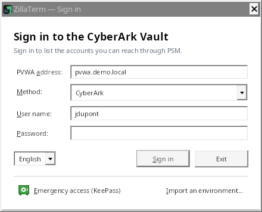

Enter the PVWA address (`pvwa.mydomain.local` is enough: `https://` and `/PasswordVault` are added), choose the
authentication method, then your user name and password. If the RADIUS server asks a question (OTP code), the window
shows it and waits for your answer; "Back" (or `Esc`) returns to the sign-in fields without answering it. While you
type a password, a "Caps Lock is on." warning shows if the key is on (likewise for KeePass databases and the local
vault).

The address, method and user name are remembered; **the password never is**.

The list at the bottom left changes the interface language (Français, English, Italiano); the window reopens right
away in the chosen language, keeping the address and user name you typed.

### Main window

- **Side panel**: "Available", "My servers", "Files" and "Intervention" tabs (`Ctrl+1` to `Ctrl+4`); the "Files" tab
  only shows while an SSH or files session is open, the "Intervention" tab while an intervention is recorded
  ([section 8](#8-intervention-recording-and-on-call-duty-reminder)). Drag the splitter to change its width; `Ctrl+B` or
  a double-click on the splitter collapses it (the strip of tabs stays: a click on a tab opens it again). `F6` moves
  from the panel to the session. The window position and size, the panel width and whether it is collapsed are
  remembered.
- **Session tabs**: a dot shows the state of the session by its colour and by its shape, readable in high contrast
  too: orange ring while connecting, solid green dot once connected, half-filled orange dot when the connection is
  interrupted, grey square when the session has ended, red cross when it failed (the name is then dimmed). The
  tooltip gives the full name, the state and the mode: "Through the PSMP …: session managed by
  CyberArk" or "Direct emergency access (KeePass): outside CyberArk, written to urgence.log". A name that is too long
  is truncated; a name already open is numbered ("srv01 (2)"). When the tabs no longer fit, the strip scrolls (mouse
  wheel, the selected tab stays visible) and "⌄" lists them all with their state. `Ctrl+Tab` / `Ctrl+Shift+Tab`:
  next / previous tab; `Ctrl+F4` or `Ctrl+Shift+W`: close the tab.
- **Closing a connected session** (SSH, remote desktop, VNC) asks for confirmation, with a "Don't ask again when
  closing a session" box (the "Confirm before closing a connected session" setting, Settings › General). On
  "Sign out of CyberArk" (which closes every tab) and on exit, a single window sums up what will be closed: sessions,
  transfers running, edited files not sent back.
- **Confirmations**: the buttons say the action ("Delete the account", "Replace the key and connect"…), "Cancel" is
  the default button, and the server, account or safe concerned is named. Values to compare (fingerprints) are shown
  in a fixed-width font with "Copy". Some irreversible actions (deleting an account, accepting a server key that
  changed) also require ticking a box.
- **Greyed-out buttons**: their tooltip says what is missing (selection, PSMP, SSH session for "Parallel"…). In
  emergency access, the buttons specific to CyberArk are hidden.
- **Status bar**: an ordinary message clears after 10 seconds; an error stays until the next message. The number of
  accounts only shows with the "Available" tab.
- **Error messages**: the common PVWA refusals (password refused, account suspended, password expired, reason or
  ticket required, dual control, missing rights, session expired) and the common connection errors (SSH
  authentication refused, server name not found, server not answering or refusing the connection, connection cut)
  are explained and say what to do; the original text follows ("PVWA message: …" or "Details: …"), to pass on as is
  to the CyberArk team or to support.
- **CyberArk session expired** (PVWA inactivity timeout): a window asks for your password (and the RADIUS response if
  needed) to sign in again, with the same address, user and method. Tabs, open sessions and transfers stay as they
  are; the action that hit the expiry is run again (accounts reload, connection). "Later" keeps working without
  CyberArk: F5, or the next CyberArk action, offers it again. When the session expires while ZillaTerm is in the
  background, the window shows when you come back to it.

## 2. Find an account: "Available" tab

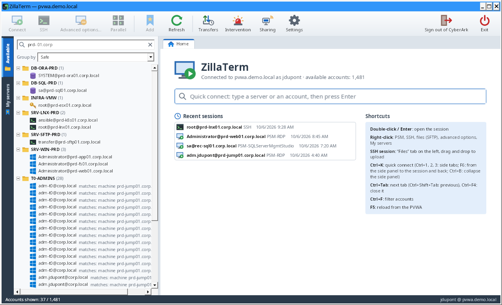

- The search box ("Filter accounts…", `Ctrl+F`) filters on every field (server, user, safe, platform, domain…),
  several words allowed (`prd sql`). The ✕ at the end of the box (as in every search or filter box) or `Esc` empties
  it. When the word searched for does not show in the row, the reason shows in grey to the right of the account
  ("matches: machine srv01", "matches: safe PROD"…).
- Several accounts shown under the same name (`user@address`) in a folder are told apart by a grey text to the
  right: their allowed machines ("→ srv01, srv02 (+2)", "→ any machine"), otherwise their platform, their
  safe or their name in CyberArk. Screen readers read it with the name of the account.
- Instead of an empty list, the tab says what is going on: accounts loading, loading failed with its message and
  "Retry", no account available to your CyberArk user, or no account matching the filter, with "Clear the filter".
- **Loading the accounts**: the PVWA gives them in pages of 1,000. From the second login on, the list from the
  previous login shows at once ("List from 10/15/2026 8:12 AM: updating 12,000 / 50,000"): search, connections and
  recent sessions work right away; the list read again from the PVWA replaces it in one go once complete, keeping the
  selection, the open folders and the scroll position, and the status bar says what changed ("14 new, 3 removed"). An
  account deleted in the meantime is refused by the PVWA when you connect. If the update fails, the list stays with
  its date ("not updated") and `F5` tries again. Without a previous list (first login, another PVWA or user), the list
  fills in page by page. The copy of the list holds no password; it is encrypted for your Windows account, one per
  PVWA and user, and deleted after 30 days (option in the [Settings](#settings-and-configuration-file)).
- "Group by" sorts accounts by safe, platform or target type.
- Right-click an account → "Export the displayed accounts (CSV)…" saves the accounts shown (filtered by the
  search) to CSV.
- **Safe members**: right-click an account (or a safe when accounts are grouped by safe, or a server in "My
  servers") → "Safe members". The window lists the users and groups of the safe with their rights (list, use,
  retrieve, add accounts, update, delete, manage members…), shows who can **add accounts**, and details every right
  of the selected member. While reading, it shows "Loading the members…"; on an error, the message is shown in the
  middle with "Retry". The PVWA only gives this list to an account with the "View Safe Members" right on the
  safe. `Ctrl+A` then `Ctrl+C` copies the table. With the "Manage safe members" right, the "Add a member…", "Edit
  the rights…" (or double-click) and "Remove…" buttons manage the members: name, type (user or group), directory
  ("Vault" or the LDAP domain), optional end date and the 22 rights, grouped as in the PVWA. The "Profile" list
  ticks at once the rights of a common use (read only, account user, account manager, full); sensitive rights are
  flagged and granting them asks for confirmation; "Changes: +n / −n" sums up what changes. Removing a member is
  confirmed ("Remove the member").
- **Add an account**: right-click an account (or a safe when accounts are grouped by safe) → "Add an account to the
  safe…". Safe, platform, address and user name are required; logon domain, account name, password, allowed machines
  and CPM management are optional. The account you clicked is used as a template (safe, platform, domain) and the
  cursor is put in the first empty required field. The
  account is created with the rights of your session: the "Add accounts" right on the safe is required, and usually
  "Update account content" to give the password. The list is then reloaded and the new account selected.
- **Import accounts (CSV)**: right-click an account or a safe → "Import accounts (CSV)…". A window asks for the file
  ("Save a template…" gives an example), the default safe and platform, then shows a preview of every line of the
  file (lines with an error in red, "Errors only" box) and the safes concerned; nothing is sent before the "Create N
  accounts" button. Required columns: address and user name (plus
  safe and platform, otherwise the defaults); optional: name, domain, password, allowed machines, CPM management
  (yes/no), reason. Separator `;`, `,` or tab, column names in English, French or Italian; a file made with "Export the
  displayed accounts" can be imported again. A second window then creates the accounts line by line and shows each line's status
  (created, refused with the PVWA message, not imported, not sent; "Stop" available). Closing it during the import
  asks for confirmation: "Continue" (the default) or "Stop the import" (the account being created is finished, the
  accounts already created stay in the CyberArk Vault). At the end it offers to save
  the result as CSV (without the passwords). The file's passwords are never shown; delete the file after the import.
- **Edit / delete an account**: right-click → "Edit the account…" (platform, address, user name, domain, name,
  allowed machines, CPM management; only the changed fields are sent) or "Delete the account…": the confirmation
  says that the account is deleted for every user and that its password can no longer be retrieved; you must tick
  "I understand that the current password will no longer be retrievable".
  Rights "Update account properties" and "Delete accounts".
- **Password status (CPM)**: an account's tooltip tells whether the CPM manages it, and the date of the last change,
  verification and reconciliation; a **⚠** marks an account whose last CPM operation failed.
- **Right-click → "Password"** ("Available" accounts and "My servers" servers):
  - "Verify (CPM)", "Change (CPM)…", "Reconcile (CPM)…" ask the CPM for the operation (confirmation to change and
    reconcile, with the "Change the password" and "Reconcile" buttons; right "Initiate CPM account management
    operations"). The CPM then handles it: `F5` shows the new status.
  - "Copy the password…": the window names the account and its safe, and says that the retrieval is recorded in the
    CyberArk audit and that the password stays 20 seconds in the clipboard. Reason and ticket are optional, unless
    the platform requires them; "Retrieve and copy" copies the password **without showing it**, then the status bar
    counts down the seconds before it is cleared ("Retrieve accounts" right).
- On the Home tab, **quick connect** (`Ctrl+K`; the cursor is there at startup) finds a server as you type: press
  Enter to connect. It says when no account matches, and only shows the first 50 results ("First 50 of N accounts:
  type more to narrow the search."). The **recent sessions** are dated ("Today 09:28", "Yesterday 18:02");
  right-click → "Remove from the list" (or `Del`) removes one. They stay greyed out until the accounts are loaded
  from the PVWA ("waiting for the PVWA accounts…"), unless the list from the previous login is shown; they are those of the PVWA you are signed in to: the same account
  ID means another account on another PVWA.

## 3. Open a PSM session (remote desktop)

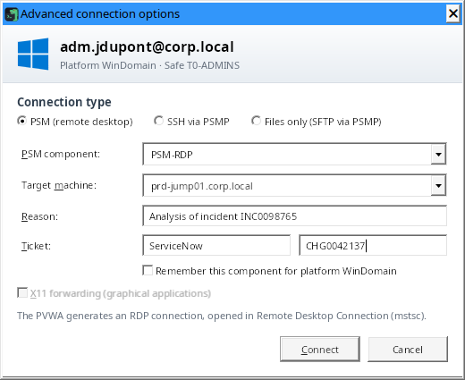

Double-click the account (or press Enter, or the "Connect" button); a Unix account opens over SSH through the PSMP
when its address is set, or as files only for an "SFTP" platform (see 4.), and "Advanced options…" then lets you
choose the PSM. ZillaTerm requests the
connection from the PVWA and opens the session in Windows **Remote Desktop Connection** (`mstsc`), exactly like the
PVWA "Connect" button: the PVWA's RDP file is handed over as is. A component that opens a remote application
(RemoteApp) opens its windows on this computer's desktop.

**PSM sessions in a tab** ("Open PSM Windows sessions in a ZillaTerm tab" option, Settings › Remote desktop, off
by default): ZillaTerm reads the PVWA file itself and opens the session in a tab with the FreeRDP Remote Desktop client
it includes: no `.rdp` file, no Windows warning about its publisher, no separate window.

- **Opening**: the tab opens at once, as for a PSMP session; a progress bar stays in it while ZillaTerm requests the
  session from the PVWA and then connects to the PSM, until the session shows. If the PVWA refuses the request (reason
  required, unknown component…), the tab closes and the connection window says why.
- **Desktop or remote application**: a Windows desktop and a remote application alike (RemoteApp:
  `||PSMInitSession`, PSM-RDP, PSM-SSH, WinSCP components…) show in the tab. The application's windows are placed
  there as on a desktop; none opens on this computer's desktop.
- **Size**: the session takes the size of the tab when it connects and keeps it. If the window changes size, the
  picture is scaled: the PSM opened its connection to the server at that size. The session never goes full screen,
  even if the PVWA file asks for it. With the option "Resize the remote desktop with the tab" (Settings › Remote
  desktop, on by default), the resolution of the PSM session follows the tab each time it is resized, without scaling;
  depending on the PSM configuration, the connection to the target server may keep its original size: turn the option
  off then, the session keeps a fixed size and its picture is scaled to the tab.
- **Keyboard**: when the tab has the keyboard (click in the session), all keys go to the session, Windows shortcuts
  included (Alt+Tab, Windows key). Click elsewhere in ZillaTerm to get them back. A tab chosen with the keyboard
  (`Ctrl+Tab`, `Ctrl+F4`…) does not take the keyboard: `Ctrl+Tab` thus goes through the remote desktop tabs; `Enter`
  on the tab, `F6` or a click in the session gives it the keyboard.
- **PSM certificate**: read by ZillaTerm while the progress bar shows, before anything is sent to the PSM (neither
  token nor user), and checked with the authorities Windows trusts (PSM name, dates, revocation when it can be
  reached). Trusted: nothing to confirm. Otherwise (self-signed certificate, issued for another name), ZillaTerm shows
  its fingerprint and asks you to confirm once, then remembers it, like an SSH key. A load-balanced PSM address can
  hide several servers, each with its own certificate: another certificate is flagged, then accepted as another PSM
  server (the known ones stay accepted) or in place of the known ones (renewal), after confirmation. After a question,
  the connection starts with a new token requested from the PVWA. Never a connection without a check, never a
  question during the connection, never a question from Windows. A PSM certificate issued by the company authority,
  to ask the CyberArk team for, avoids the confirmations.
- **Redirections** (clipboard, drives…): those the PVWA asks for, never more. No picture of the session is kept on
  disk.
- **This computer's drives**: the option "Share this computer's drives" (Settings › Remote desktop, on by
  default) asks the PVWA for them, like the "Map local drives" box of its connection window
  (`AllowMappingLocalDrives` parameter). When the connection component allows it, the PVWA writes them into the RDP
  file and they appear in the session (File Explorer › This PC), in the tab and in Remote Desktop Connection alike.
  With the option off, no drive is shared in the tab, even if the PVWA asks for it (choice kept in the PVWA, component
  setting); Remote Desktop Connection follows the PVWA's signed file, which cannot be modified.
- **Display paused**: the option "Pause the display of sessions nobody is watching" (Settings › Remote
  desktop, checked by default) asks the server to stop sending the picture of a session in a tab when the tab has
  been in the background, ZillaTerm minimized or Windows locked for 1 minute, or when nobody has used the keyboard or
  mouse for 15 minutes; the tab then shows "Display paused". The session stays open: the picture comes back as soon as
  you return to the tab or move the mouse, and the keyboard goes back to the session only afterwards (the key that
  wakes the tab is not sent to it). No display traffic, and no picture encoding by the PSM, for a session nobody sees.
  Never for the tab shown while an intervention is being recorded or the session is shared. During a recording, the
  pause of a tab in the background is marked in it: the report's player shows "Display paused" on the screen and a grey
  band on the timeline (see [Intervention](#8-intervention-recording-and-on-call-duty-reminder)).
- **Reconnect**, "Duplicate tab": new request to the PVWA (a PSM session token is used only once); reason and ticket
  stay those of the first connection. If the CyberArk session has expired in the meantime, the sign-in window is
  offered, then the request starts again.
- The tab shows the server's tag (PROD, QA…) and its coloured frame; "Capture" adds a picture to the log of an
  intervention being recorded.
- A connection through a Remote Desktop gateway still opens in Remote Desktop Connection; so does the session if the
  FreeRDP client cannot be launched on the computer (computer policy, for example): the status bar says so.

- **PSM component**: deduced from the platform (`PSM-RDP` for Windows, `PSM-SSH` for Unix and network,
  `PSM-SQLServerMgmtStudio`, `PSM-SQLPlus`…). Tick "Remember this component" to keep it for the whole platform. Your
  PVWA may name its components differently (for example `WIN-PSM`): enter the name its "Connect" button offers; the
  list then offers the components already used, the platform's first. For all your Windows accounts, set the
  component once in **Settings › CyberArk** ("Component for Windows accounts", for example `WIN-PSM`); a component remembered for a
  platform still comes first. Per-platform components are shown and edited in the same place ("Component per
  platform").
- **Domain accounts**: an account registered for its domain has no server. It is recognized by its domain platform,
  being restricted to its allowed machines, or its address: its logon domain, a domain with other servers below it
  (`corp.local` when an account targets `srv01.corp.local`), or the domain of the PVWA or of the workstation. A local
  account whose logon domain is the server name (`srv01.corp.local`, `SRV01`) stays an account of that server when
  another account in the vault targets it (local account, Unix account) or when its platform is a server or desktop
  platform ("Server", "Srv", "Desktop", "Workstation"). An account that only lists machines, without being restricted
  to them, opens on its own address; the target machine stays optional. Never a session to the domain
  itself: the server is always asked, "Advanced options…" included. The "Choose the server" window asks which one to open the session on: the list offers
  the servers already used with this account (recent sessions, "My servers"), then its allowed machines; an account
  restricted to its machines refuses the others. "Keep this server in “My servers”", with the folder and the
  [tag](#tags-prod-qa-dev) you want (chosen in the same window), adds it after a successful connection, named
  `account@server` (the choice and the folder are remembered for next time; the box disappears when the server is
  already there). "Advanced options…" opens the full window with this server.
- **Reason and ticket**: if the PVWA refuses the request (reason or ticket required, component not configured…), the
  window says what to do, followed by the original PVWA message, and you can fix it and try again.
- The "Advanced options…" toolbar button (or right-click → "Advanced options…") opens this window, "Advanced
  connection options", on demand. The two ticket fields (system, number) are named for screen readers; the label
  column widens with their text. The cursor
  is put in the first usable field; over SSH or files only, the fields used only by the PSM are greyed out and
  their tooltip says so; without a component, the window asks you to choose one.

## 4. Open an SSH session through the PSMP

Set the PSMP once in **Settings › SSH** (see [PSMP by domain](#psmp-by-domain) if you have several).
Double-click (or Enter) then chooses from the name of the account's platform:

| Platform name | Opened by default |
| --- | --- |
| contains "SFTP" (`UnixSFTP`, `SFTP-Partners`…) | **files only** over SFTP through the PSMP (see below) |
| contains "SSH" (`UnixSSH`, `CiscoSSH`…), or another Unix platform | **SSH** through the PSMP |
| other | **PSM** (remote desktop) |

Right-click always offers the three (the default is in bold): "Connect (PSM)", "Connect over SSH (PSMP)" (or the
"SSH" button) and "Open the files (SFTP, PSMP)".

**Files only**: a single PSMP SFTP session, without a terminal. A tab shows its state, the server and a "Show the
files" button, which opens the "Files" tab of the left panel and widens it if needed so that all its columns fit. The
files are there, with the same functions (checked transfers, queue, editor, compare, live follow, permissions),
except what needs a terminal (following the terminal folder, extracting a `.tar.gz` archive). Useful to just drop or
fetch files, or when the platform allows PSMP-SFTP but not the shell. Like every PSMP session, it is recorded and audited by
CyberArk.

The session opens **in a ZillaTerm tab**, at once: a progress bar shows while ZillaTerm asks the PVWA for the MFA key
and connects to the PSMP (server key, password or code questions show up meanwhile). It uses the standard PSMP login
`<you>@<target account>[#domain]@<target server>`. User names containing spaces (`John Smith`, `Local Admin`) are accepted. The side panel switches to the
server's "Files" tab (a collapsed panel stays collapsed).

### Graphical applications (X11)

Graphical applications started in an SSH session (`xclock`, Oracle installers, `xterm`…) can show on your computer,
as with `ssh -X`:

1. Install an **X server** on the computer (VcXsrv, X410, Xming…) and start it with **local TCP connections**
   allowed: display `:0` listens on port 6000. The X server is set in **Settings › SSH › Local X server** (`:0`
   by default; this computer only, since the X protocol is not encrypted).
2. Tick **"X11 forwarding (graphical applications)"** for the server: right-click → "Properties…" in "My servers", or
   in "Advanced options…" for a single connection. SSH sessions only; unticked by default. Once ticked, the box
   recalls its effect just below ("⚠ Effect: a compromised server could see the other X windows of this computer and
   send keystrokes to them.").
3. Open the session: a grey line tells whether forwarding is active, refused (by the server, whose `sshd_config` needs
   `X11Forwarding yes`, or by the PSMP) or whether no X server is listening on the computer.

ZillaTerm gives the server a **fake cookie**: every X11 connection must present it, and it is removed before anything
reaches the computer's X server; a connection without this cookie is closed. ⚠ For trusted servers only: a compromised
server could see the other X windows on the computer and send keystrokes to them. The choice is personal: it is
neither exported nor put in a shared list.

### PSMP by domain

With one PSMP per domain, declare them in **Settings › SSH**: a **default PSMP** and the **PSMP by domain** list
("Add a PSMP", address, port; the domain served is the one of the address, and can be changed). Each server goes
through the PSMP of the domain **closest to its own**:

| Configured PSMPs | Server | PSMP used |
| --- | --- | --- |
| `psmp.xxx.corp.com`, `psmp.zzz.corp.com` | `srv01.xxx.corp.com` | `psmp.xxx.corp.com` |
| same | `srv02.zzz.corp.com` | `psmp.zzz.corp.com` |
| `psmp.xxx.corp.com` only | `srv03.zzz.xxx.corp.com` | `psmp.xxx.corp.com` (no PSMP for `zzz.xxx.corp.com`) |
| same | `srv04.other.org`, an IP address | the default PSMP; without one, the only PSMP of the list if there is just one |

Without a PSMP for a server (several PSMPs, no default, domain not covered), the connection is refused and the status
bar says so. "Which PSMP for the server" gives the answer before saving; two PSMPs for the same domain are refused.
Only the PSMPs of the list receive your CyberArk password, never an address deduced from a server name; the key of
each PSMP is checked on its first connection. The tab tooltip names the PSMP used.

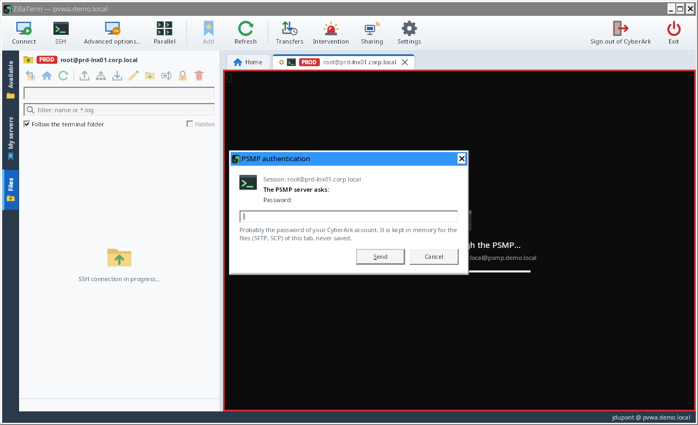 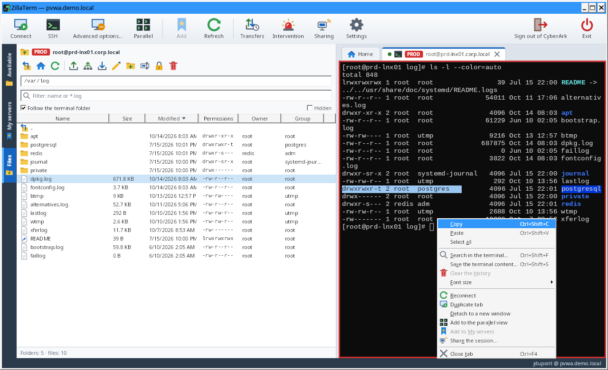

- **Authentication**: if the PVWA provides an "MFA caching" key, no question is asked. Otherwise the PSMP questions
  (password, MFA code) are shown in a window that names the session concerned, with help depending on the question:
  probably the password of your CyberArk account (reused for the SFTP and SCP connections of the same tab, never
  saved), or the MFA code (asked again at each connection). A refused answer is shown in red above the field with the
  attempt number ("Attempt 2 of 3"); after three refusals the connection stops so that your account is not locked.
  "Caps Lock is on." shows while you type. When several sessions open together (folder, selection, parallel view),
  the window offers "Also use this password for the other sessions being opened": ticked, it is asked only once
  (never for an MFA code) and kept in memory only until they are connected. The passwords kept for the tabs are
  forgotten when Windows locks.
- **PSMP key**: on first connection, a window shows its SHA-256 fingerprint in a fixed-width font, with "Copy":
  compare it with the one published by your CyberArk team before "Trust and connect" ("Cancel connection" is the
  default button). The fingerprint is then remembered on this computer. If the key changes, a red banner warns of a
  possible interception, the remembered and the new fingerprints are shown, and "Replace the key and connect" is
  only possible after ticking "I confirmed this change with the CyberArk team". A refused key stops the connection
  ("Connection cancelled: the server key was not accepted."). A PSMP can have keys of several types (RSA,
  ed25519…): each one is remembered separately, and ZillaTerm asks for the known type first. A key of a type never
  seen for this PSMP is neither accepted silently nor taken for a change: the "New key of the PSMP, of another type"
  window shows the fingerprints already accepted and the new one, and "Accept this key and connect" is only possible
  after ticking "I checked this fingerprint with the CyberArk team".
- **Terminal**: selecting copies, the mouse wheel or the scroll bar on the right goes through the history; once you
  have scrolled up, "↓ Back to the end" (or typing) takes you back to the end. Precision touchpad scrolling is
  tracked finely (history, `less`, `vim`), as is zooming with `Ctrl`. A command, a path or a URL too long for the
  width, wrapped over several lines, is copied as a single line, "Save the terminal content" writes it whole, and the
  search finds a word split by the wrapping. A window that opens during a mouse selection stops it and copies it.
  `\e[3J` (`tput E3`) only clears the history, not the screen. AltGr works on international keyboards. Close the tab
  with its cross, a middle click or `Ctrl+F4` (confirmation if the session is connected).
- **End of session**: a banner at the top of the terminal gives the reason, with "Reconnect"; the last lines stay
  readable, selectable and copyable.
- **Right-click in the terminal** (or the keyboard's Menu key): copy, paste, select all, search, save the content,
  clear the history (on this computer only, nothing is sent to the server), font size, and the tab's actions
  (reconnect, duplicate, detach, parallel view, add to "My servers", close). To paste with a plain right-click
  instead, tick "Right-click in the terminal pastes the clipboard" in Settings; Shift+right-click then opens the menu.
- **Pasting several lines**: when the shell would run the lines one by one (no bracketed paste), a window shows the
  lines and asks for confirmation ("Paste", "Cancel" by default), with a "Don't warn again before pasting several
  lines" box (the "Warn before pasting several lines when the shell would run them one by one" setting, Settings ›
  Terminal).
- **Appearance**: colour palette and font size in Settings (Campbell, One Half, Solarized, dark or light);
  `Ctrl+wheel` enlarges or shrinks a terminal, `Ctrl+0` goes back to the default size.
- **Search** in the terminal, history included: `Ctrl+Shift+F` (or right-click in the terminal or on the tab).
  Matches are highlighted; `Enter` goes up to older ones, `Shift+Enter` goes down, `Esc` closes.
- **Save the content** of the terminal (history and screen) to a text file: `Ctrl+Shift+S` (or right-click in the
  terminal or on the tab). Only when you ask: the file may contain sensitive information.
- **Detach a tab** (another screen): drag the SSH tab out of the window, or right-click → "Detach to a new window".
  The terminal moves to a separate window and the session goes on. The tab keeps its place ("Show the window",
  "Bring it back here") and the Files tab works on this session when it is selected. Closing the separate window
  brings the terminal back to its tab without closing the session. Remote desktop tabs do not detach: maximize the
  ZillaTerm window on the screen you want ("Full screen" only exists with the Windows Remote Desktop control); a PSM
  session opened in Windows Remote Desktop Connection is already a window of its own.
- **Parallel view** (up to 8 sessions on screen): "Parallel" toolbar button (greyed out while no SSH session is
  open), or right-click an SSH tab → "Add to the
  parallel view". Tick the open SSH sessions to show together (8 at most): they are laid out as a grid in the
  "Parallel" tab, side by side up to 3, then on two rows. Each session has its title and state (a ring while
  connecting, a full dot afterwards); "⤢" (or a double-click on the title) enlarges it alone, "✕" sends it back to
  its tab. The session you type in has a thicker frame and the "⌨ Typing here" mark. The Files tab follows the
  session you work in. "Close the view" gives each terminal back to its tab without closing the sessions. Remote
  desktop sessions cannot go there.
  - **Simultaneous typing**: "Simultaneous typing" button of the view. What you type in a ticked session ("Receives
    the typing") is also sent to the other ticked, connected sessions: the same command on several servers. It is
    **off every time the view opens**; when on, the button turns amber with "ON (n)", an amber banner gives the
    number and names of the sessions receiving the typing, and an amber frame surrounds them; unticked sessions are
    dimmed and marked "excluded". A session added while it is on is not ticked; what is
    typed in an unticked session only goes to it. Each key is encoded by the session that receives it (arrows work
    in a shell as in vim). The mouse wheel is not copied, and pasting several lines into several sessions asks
    first.
  - **From "My servers"**: right-click a folder → "Open in the parallel view" connects its SSH servers (subfolders
    included) and puts them straight in the view; or pick servers with `Ctrl+click` (`Shift+click` for a range),
    then right-click → "Open the N servers in the parallel view". Beyond the free places (8 at most), a window asks
    which ones to open; Windows (PSM) servers are left out. Each connection stays a separate PSMP session, with its
    usual questions.
  - **Separate window**: "Separate window" button of the view, right-click the "Parallel" tab, or drag the tab out
    of the window. Closing it brings the view back to its tab without closing the sessions.
  - **Send files** to the sessions of the view: "Send files…" button (see the Files tab).

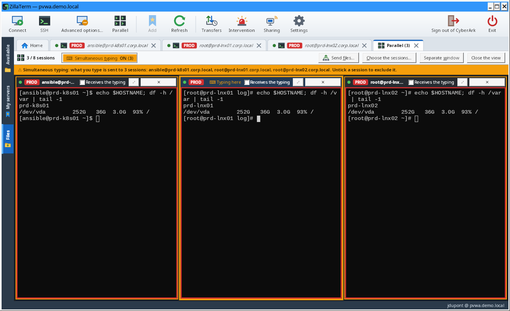

## 5. Browse and upload files: "Files" tab

The **Files** tab of the side panel (`Ctrl+3`) follows the active SSH tab and comes to the front when an SSH session
opens; it only shows while an SSH or files session is open. It also serves the files-only sessions, which show it when they open: CyberArk accounts over
SFTP through the PSMP ([section 4](#4-open-an-ssh-session-through-the-psmp))
and KeePass SFTP, FTP, FTPS entries ([section 7](#7-emergency-access-outside-cyberark-keepass-databases)).

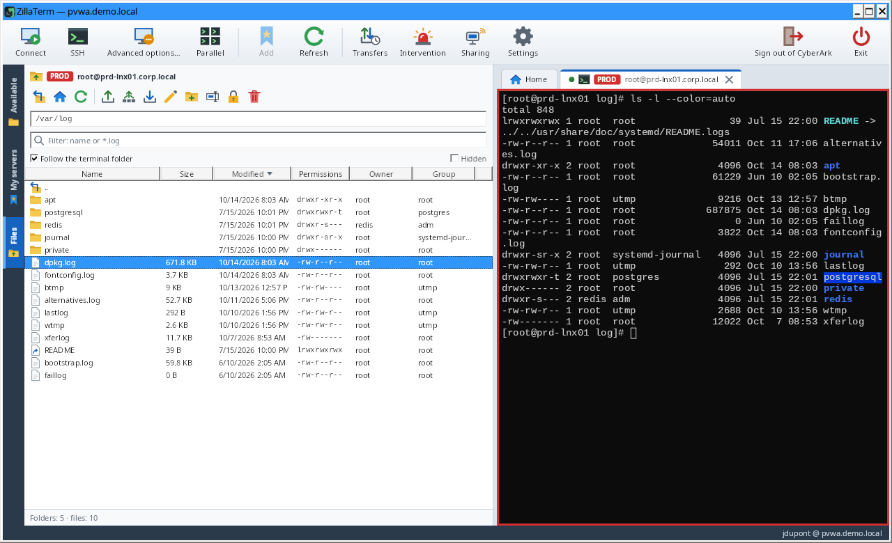

- **Tab badge**: on the "Files" tab, a badge gives the number of transfers running or waiting, or "!" for a failed
  or differing transfer you have not seen yet (showing the tab marks it as seen). The ZillaTerm button in the
  Windows taskbar also shows the activity or the failure. With no session open, the tab is hidden: the "!" moves to
  the "Transfers" toolbar button, and opening the transfer history marks it as seen.
- **Path bar**: current path, editable (type a path, then Enter). Double-click a folder to enter it, `..` to go up,
  "parent folder" (its icon differs from the "Upload" one) and "home folder" buttons.
- **Columns and sort**: click a column header (Name, Size, Modified, Permissions, Owner, Group); click it again to
  reverse the order (an arrow shows it). Size and date start with the largest and the newest. Folders stay on top; the
  sort is kept from one folder and one session to the next. The Name column takes the width left by the others; when
  the panel is narrow, the Group, Owner and then Permissions columns are hidden rather than cut (they come back when
  the panel is widened): "+n" at the end of the header shows it, with their names in a tooltip.
- **Choose the columns**: right-click the list header (or click "+n"): one box per column (Size, Modified,
  Permissions, Owner, Group), kept from one time to the next; a ticked column without room is marked "no room".
  "Widen the panel to show them all" gives the panel the missing width (the session keeps at least 360 pixels).
  Unticking Size or Modified makes room for Permissions and Owner in a narrow panel.
- **Owner and Group**: hovering shows `owner:group` (as for `chown`). These are the names that the server sends with
  the file list, as shown by `ls -l`. Over SFTP, if the line that holds them does not have the usual shape (a name with
  a space…), ZillaTerm shows the numbers instead (UID and GID, as `ls -n`); over FTP, the columns stay empty if the
  server gives no names.
- **Toolbar buttons**: Download, Edit, Rename, Permissions and Delete are greyed out, as in the menu, while the
  selection does not fit; their tooltip says what to select ("Select a single file (not a folder)."…).
- **Upload files**: drag them from Explorer onto the list (or the "Upload" button). Sent over **SFTP** by default
  (SCP can be chosen in Settings), folders included; a whole drive (`E:\`) or the root of a share is refused, with a
  message. Dropped on a folder row, they go into that folder: the row is
  highlighted and the status bar shows the destination ("Drop into server:/path"). If items already exist on the
  server (hidden ones included, even when they are not shown), a confirmation names the server and the items, and
  offers "Replace", "Skip existing" or "Cancel" (the default); a replaced file is rewritten in place and stays
  incomplete if the upload is cancelled or fails. If the server
  refuses that protocol for a file before receiving it (rule of the PSMP, read-only SFTP…), the other one takes over
  at once, with no question and no wait: the status bar and the summary show it with the server's answer, and so does
  the transfer history ("SCP (SFTP refused)"). Over SCP, after a refusal when a file is announced, files at least as large go
  straight over SFTP until the tab is closed.
  In an uploaded folder (or one packed into a .tar.gz archive), symbolic links and junctions to folders are not
  followed, as for downloads: a junction can loop or lead to a forbidden folder ("My Music" of old Windows profiles).
  They are reported in the summary ("↷ n link(s) to a folder not followed") and in "Details", with their target; a link
  to a file is sent with the content of that file.
- **Download**: "Download" button or right-click. One file asks where to save it; several go to a folder you choose,
  with one question ("Replace") for the files already there. A local file is replaced only once its download is complete: an
  interrupted or cancelled download leaves it as it was. The file being downloaded goes to a temporary copy in the
  same folder (`name.xxxxxxxx.part`, or `zillaterm.xxxxxxxx.part` for a name longer than 241 characters: names can be up
  to 255 characters, the Windows limit). "Download" only takes files: for a folder, the status bar
  reminds you to drag it to File Explorer or to the desktop.
- **Download by dragging**: drag files or folders from the list to Explorer or the desktop. Nothing is downloaded
  while dragging: on drop, a window shows the progress (Cancel stops it), then Explorer copies the files where you
  dropped them. Unix names are made valid for Windows (`\`, `:`, `..`, `CON`… replaced), never writing outside the
  drop folder; the temporary download folder is deleted afterwards.
- **Transfer queue**: uploads and downloads run one at a time, in the order requested; what you ask for during a
  transfer is added to the queue instead of being ignored. An upload goes to the folder shown when you dropped the
  files (or to the folder they were dropped on), and the overwrite confirmation also counts uploads still waiting.
  The "Upload" window and the "New folder" question name the server and the folder: the upload, the download or the
  new folder always go there, even if you switch sessions during the question (parallel view, detached terminal) or
  if the panel follows the terminal. The "Transfers" panel, above the status bar, shows each item with its server
  (waiting, progress and file n/N, check, result): ✕ removes a waiting item, "Cancel" stops the running one,
  "Cancel all" cancels everything left.
  The results stay shown once the transfers are over: "✓ done · SHA-256 verified (n/n)", "⚠ done · not verified: n
  of N", or the failure in red; "Details" on a finished line shows the SHA-256 checksum of each file, and "Clear
  finished" removes the finished, failed and cancelled transfers from the list (the transfer history keeps them).
  A stopped transfer deletes the file being transferred, which is incomplete (on the
  server for an upload, on this computer for a download); files already transferred stay. An upload stopped through a
  symbolic link of the server keeps the link and the file it points to, and the summary says so. A download also
  stops when the server sends far more than the announced size (double, or 64 MB more): the incomplete copy is
  deleted. Beware: if the upload was
  replacing an existing file and had started writing it, its old content is lost; stopped before any content, the
  server file stays as it was. Over SCP, stopping ends only that transfer: the next items go
  on over the same connection; a transfer that no longer moves (server not reading) stops 2 s after "Cancel" and the next
  ones go on over a new connection. A file sent over SCP gets the upload date on the server (as `scp` without `-p`, and as over SFTP). An error is shown in red in the queue
  and the queue goes on; at the end, a single summary in the status bar of the tab (three lines at most, full text
  in the tooltip). Browsing, deleting, permissions, the editor and dragging to
  Explorer get in between two files. Closing the tab with transfers running asks for confirmation ("Cancel the
  transfers and close" or "Keep transferring"); on sign-out and on exit, they are listed in the summary window.
- **Many files at once: .tar.gz archive**: from 200 dropped files (threshold in Settings, option "Offer a single
  .tar.gz archive"), ZillaTerm offers to send them in a single archive: one file to transfer and check instead of
  thousands, much faster through the PSMP. The archive is made on this computer (in the queue, can be cancelled),
  sent and checked (SHA-256), then deleted from this computer; each dropped item is at the root of the archive
  (permissions 0644 and 0755). Nothing is run on the server: an orange box shows up at the bottom of the Files tab
  with the extraction command, for example `cd '/opt/app' && /usr/bin/gzip -dc './deploy.tar.gz' | tar xof - && rm -f
  './deploy.tar.gz'` (the archive is deleted from the server once extracted). The extracted files belong to whoever
  extracts them (`o`), and only empty folders have an entry in the archive: a folder that already exists keeps its
  permissions and owner. The archive is not offered when the drop replaces items on the server: the one-by-one upload
  rewrites them in place (permissions, owner and ACLs kept), and the replace question says so. "Copy the command", or
  "Type it in the terminal", which types it at the prompt of the session without running it: check it, then press
  Enter. The box stays (for that session) until you close it. "Send the files one by one" keeps the usual upload;
  "Don't offer again" turns the option off.
  - **Every Unix** (Red Hat 5 to 9, HP-UX 11.11 and 11.31, Solaris, AIX…): the archive is in the standard POSIX tar
    format (ustar), read by every tar, and the command uses `gzip` and `tar xof` separately, with no GNU tar specific
    option. It can be typed in any shell (sh, ksh, bash, zsh, csh, tcsh).
  - **gzip** is looked for on the server (through SFTP) where each system installs it: `/bin`, `/usr/bin`,
    `/usr/contrib/bin` (HP-UX), `/usr/local/bin`, `/opt/freeware/bin` (AIX), `/usr/sfw/bin` and `/opt/csw/bin`
    (Solaris). Not found: the archive is sent uncompressed (`.tar`), extracted by `tar` alone.
  - A name over 100 characters (folders excluded) or a file over 8 GB does not fit this format: the files are then
    sent one by one, with a message.
- **Send to several servers**: button (arrow to three servers) or right-click → "Send to several servers…". Pick the
  files or folders, the destination folder (`~` = the home folder of the account on each server, e.g. `~/deploy`)
  and the SSH sessions to send to. ZillaTerm first checks on each server that the folder exists and what would be
  replaced (a single question for all), then queues one upload per server: same protocol, same SHA-256 check on each
  server, a single summary at the end.
- **Compare**: right-click a file → "Compare with…": the same path (or another one) on a server with an open SSH
  session, or a file of this computer; with two files selected, "Compare the 2 files". "Browse…" next to the path
  opens an explorer of the other server, on the same folder with the file preselected (or on the closest existing
  parent folder): double-click a folder to enter it, Backspace to go up, typing the start of a name selects the file
  (spaces included), a path can also be typed; the chosen file replaces the path. The Files tab of that server stays
  on its folder. The same file on the same server is refused;
  with no other server open, a file of this computer is offered. The files are read **in
  memory** (50 MB at most each), without a copy on this computer. The window shows the lines side by side: removed
  in red on the left, added in green on the right. `F7` / `Shift+F7`: next / previous difference; "Ignore spaces";
  "Only the differences"; "Save the diff…" in the `diff -u` format. A binary file (or one over 10 MB) is compared by
  its size and SHA-256 checksum. With a comparison tool chosen in Settings (WinMerge, VS Code…), "Open in …" gives
  it two temporary copies, deleted when the window closes.
- **Transfer history**: "Transfers" toolbar button (up and down arrows with a clock, left of "Settings"), available
  even without a session. It lists the last 200 uploads and downloads (drag and drop included): date, direction,
  server, item, destination, number of files, protocol ("SCP (SFTP refused)" when the other protocol took over),
  result, written as in the queue; failures and differing files are in red, and the text of a column too narrow for
  it shows in a tooltip. "Uploads" / "Downloads" / "Failures and unverified" filter (failed transfers, files that
  differ or could not be read again), chosen by itself when a failure flagged with "!" has not been seen yet;
  "Checksums…" (or double-click)
  shows each file's size, SHA-256 checksums and result, and copies them in the `sha256sum -c` format to check again
  on the server; "Open the folder" for a download; "Clear the history", set apart from the other buttons, asks for
  confirmation (the files themselves are not touched).
- **Transfer check (SHA-256)**: every uploaded or downloaded file is checked. On upload (SCP or SFTP), the local
  file is hashed, then the file on the server is read again over SFTP and hashed. On download, the data received
  from the server is hashed, then the file written on this computer is read again. The status bar confirms "✓
  identical on both sides"; the checksums of each file are in "Details" in the queue and in the transfer history
  ("Transfers" button). If a file differs,
  the error is shown and the details open by themselves; a drag-and-drop download fails rather than deliver a wrong
  copy. A file that cannot be read again (permissions) is reported as "not checked". Reading an upload again doubles
  the data exchanged with the server.
- **Delete**: select, then Del (or right-click → "Delete (rm)"), with a confirmation that names the server and
  reminds you that there is no recycle bin on the server. Folders must be empty. A symbolic
  link is deleted itself, never the file or folder it points to.
- **Rename**: `F2`, right-click → "Rename…" or the toolbar button. A file is never overwritten: a name already taken
  is refused before anything is sent to the server (over SFTP as over FTP). "/", ".", ".." and control characters
  (line break, tab…) are refused, as for "New folder". A symbolic link is renamed itself, never the file or folder
  it points to.
- **Edit a file**: **double-click** the file (or `Enter`, `F4`, right-click → "Edit", the pencil button). The file
  opens in the text editor chosen in Settings (Notepad by default). On double-click, an archive, an image, an
  executable or an office document is downloaded instead of opened, as is any file whose first bytes are binary. Every time you save, ZillaTerm offers to send it back to the
  server ("Send back" or "Not now"): sent over SFTP, the file's permissions are kept. If the file changed on the
  server since you opened it, a warning says so and asks for confirmation ("Replace with my version") before
  overwriting it. Opening a file that is already open downloads it again, every time: if its content changed on the
  server (edited in the terminal, by someone else, before a reconnection…), the copy opened in the editor is replaced
  by the current version; otherwise it is left as is. Only exception: if your copy has changes not sent back and the
  file also changed on the server, ZillaTerm asks whether to "Reload the server version" or "Keep my copy". While an
  edited file is being sent back, closing the tab, exiting or signing out waits for the send-back to finish (the
  status bar says so), so as not to leave a half-written file on the server.
- **Follow a file (tail -f)**: right-click one or several files → "Follow (tail -f)". A window shows the end of the
  file, then each new line as soon as it is written, like `tail -f`, reading the file over SFTP every second: no
  command runs on the server. A file truncated or replaced by a rotation is read again from the start; the last
  10,000 lines are kept. A line longer than 8,192 characters is cut, with "… [line cut after 8,192 characters]"
  (also in copies and saved files); the rest of that line is ignored.
  - **Colours and alerts**: errors (ERROR, FATAL, CRITICAL…) in red, warnings (WARN) in orange; words of your choice
    highlighted in yellow ("Highlight", separated by commas). "Alert on" (e.g. `ERROR, OutOfMemory, Connection
    refused`): every new line containing one of these words is marked, the "⚠ n alerts" counter goes up (a click
    goes to the next one) and the window's taskbar button flashes; a Windows notification can be shown, at most one
    every 30 s, with the number of lines and the file name only, **never the content of the lines** (it may show on
    the lock screen). These settings are kept for the next windows.
  - **Combined view**: several selected files open in a single window, and "Add to a follow window" adds a file from
    another tab, so from another server. Lines are interleaved in the order they arrive, prefixed and coloured by
    file (`[root@srv01 app.log]`); at the bottom, each file has its state and a button to stop following it.
  - **Filter and search**: filter (like `grep`), exclusion (like `grep -v`), context lines (like `grep -C 3`), as
    plain text or regular expressions. A filled-in filter or exclusion box turns amber, with ✕ to empty it, and the
    status bar shows "Filter: n / N lines shown". `Ctrl+F` searches the lines without filtering them (Enter / `F3`:
    next, `Shift+F3`: previous). Scrolling up stops following the end.
  - **Disconnections**: when the connection is lost, a marker says so; when the SSH tab reconnects (or with
    "Reconnect"), following resumes where it stopped, with the lines written in the meantime. Closing the tab stops
    following its files; the window keeps the lines received.
  - **Remembered files**: on a server of the "My servers" tab, followed files are remembered (the last 12); at the
    next connection, the follow button of the Files tab offers them: "Follow them all in one window" in one click,
    or a single one.
  - **Keep a trace**: "Save…" writes the displayed lines to a file on this computer; "Record continuously…" writes
    the lines already received, then each new line as it arrives, as long as the box is ticked; "Marker" inserts a
    `—— 14:32:05 ——` line to find a moment again (before a change, for example).
  - **Connection**: by default, following uses the SFTP connection of the Files tab; it then runs between two files
    of a transfer. The Settings option "Follow files (tail -f) in an independent session" gives it its own
    connection, one per window and server: it no longer waits for transfers, but it is one more PSMP session
    (recorded separately, and an MFA validation may be asked). It is closed with the window. A lost connection is
    never reopened in a loop.
- **Permissions**: right-click → "Permissions…" (or the padlock button). Read / write / execute boxes for owner,
  group and others, special bits (setuid, setgid, sticky) and the octal value (`644`, `1777`…), for one or several
  items. When the selected items do not all have the same permissions, a box left in the middle state leaves that
  permission unchanged on each item: only the changed permissions are applied. For a folder, "Apply to the folder
  contents too" propagates the permissions to subfolders and files; by
  default, execute (x) is only given to folders and to files that are already executable. The button then becomes
  "Apply recursively…" and a confirmation says what will happen; while it runs, "Stop" in the Files tab interrupts it
  (items already done keep their new permissions). Symbolic links are not followed and the owner is not changed. Over
  FTP, a name with a control character (it would add a command for the server) is left as it is and reported as an
  error; the other items are processed.
- **Operation in progress**: while a delete, a rename or a permission change runs on one server, the other servers
  stay usable; on the same server, Delete, `F2` and Permissions are refused until it ends, and the status bar says so.
  If you have moved to another session in the meantime, the outcome of a delete or a permission change (errors
  included) is shown when you come back to it.
- **Filter**: the box under the path keeps only the items of the folder whose name contains the text (`nginx`), or
  matches a mask with `*` and `?` (`*.log`, `app?.conf`; several separated by `;`: `*.log;*.gz`), ignoring case.
  `..` stays to go up; the status bar says how many items are shown. It is cleared when you change folder; `Ctrl+F`
  in the Files tab, `Esc` or ✕ clears, `Enter` or `↓` goes to the first item.
- **Go to a file with the keyboard**: in the list, type the start of its name, as in Explorer: `p` selects the next
  item whose name starts with "p", `p` again the one after; typed in a row, the letters form the start of the name (`pro` →
  `profile`). After a one-second pause, a letter starts a new search.
- Also: new folder, download, copy path, show hidden files.
- **Follow the terminal folder**: when ticked, every `cd` in the terminal moves the browser to the same folder (see
  [How it works](#how-it-works)). After `sudo -i` or `su`, tick the box again at the shell prompt to re-enable
  tracking in that new shell.

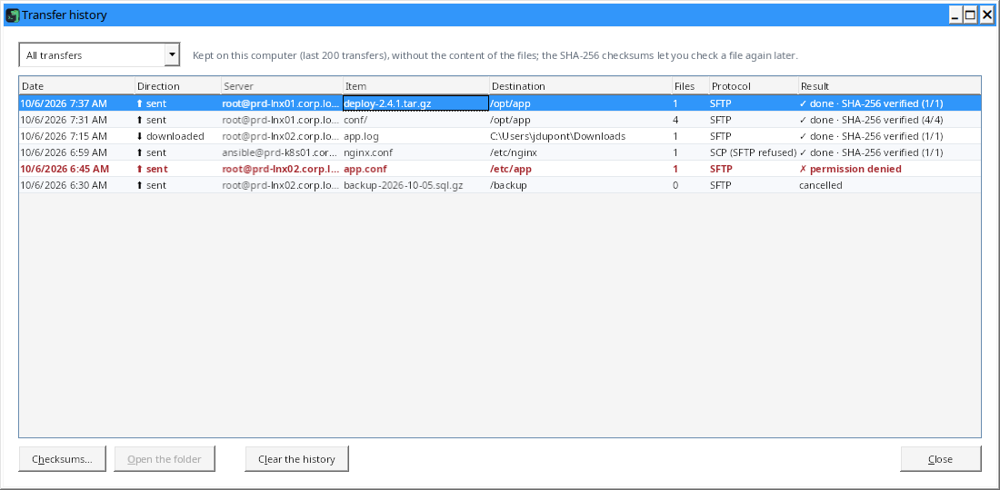

## 6. Organize your servers: "My servers" tab

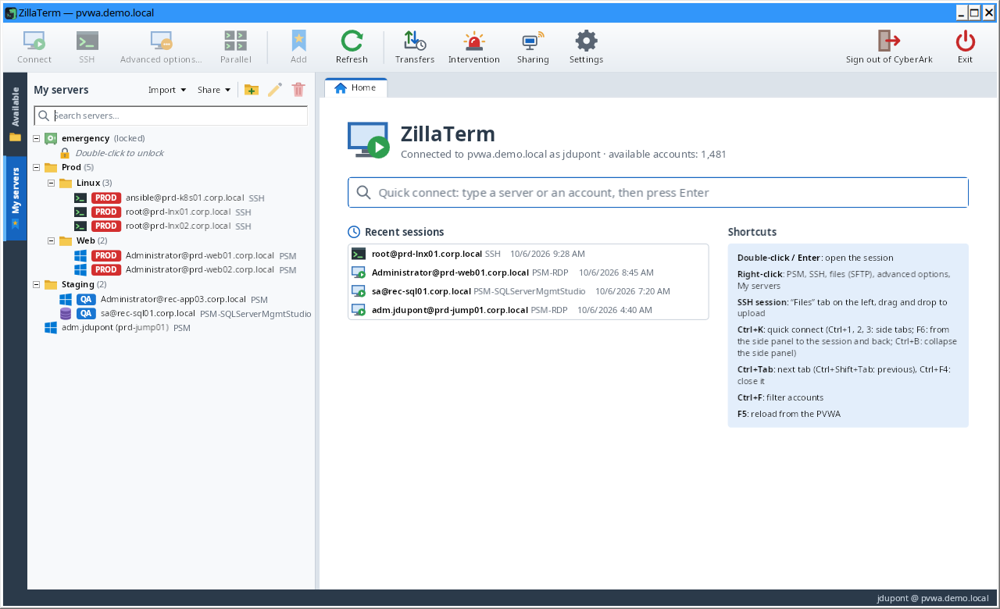

- **Add** an account: right-click in "Available" → "Add to My servers", or the "Add" toolbar button. One window asks
  for the folder (the last one chosen is offered; type a name to create a new one, `Prod/Web` for a subfolder) and the
  [tag](#tags-prod-qa-dev), suggested from its name. For a domain account, the same window asks for the server
  (optional: without a server, it is asked at each connection). You can also drag the account onto a folder of
  "My servers": the window then opens on that folder (not at all for a server account when no tag is defined).
- **Add an open session**: right-click the session tab (or in its terminal) → "Add to My servers": same window
  (folder and tag). The server keeps the connection type and the target machine; the entry is greyed out when it is
  already there.
- **Add a recent connection**: right-click in the recent sessions of the home page → "Add to My servers": same window
  (folder and tag). The server keeps the connection type (PSM, SSH or files only), the PSM component and the target
  machine used.
- **Folders**: right-click → new folder or subfolder, rename, delete; drag servers and folders to move them. Deleting a
  folder counts and deletes all its servers of this PVWA, even those hidden by the search; those of another PVWA stay.
  Removing a server or deleting a folder asks for confirmation (the accounts stay in "Available"). The "Properties /
  rename" and "Remove the server or delete the folder" buttons, at the top of the tab, are greyed out while nothing
  is selected.
- **Search**: box at the top of the tab (or `Ctrl+F` in the tab). It filters servers by name, server, user, folder,
  component, target machine, and the entries of unlocked KeePass databases; the folders of the results are expanded.
  `Enter` or `↓` selects the first result, `Esc` or the ✕ at the end of the box clears. With thousands of servers,
  the list is filtered once you stop typing.
- **Several servers at once**: `Ctrl+click` adds or removes a server (or all those of a folder), `Shift+click` picks
  a range of servers; `Esc` or a plain click cancels. With the keyboard: `Ctrl+Space` adds or removes the selected
  server, `Shift+↑` / `Shift+↓` extends the range; the arrows alone keep the chosen servers, and the Menu key (or
  `Shift+F10`) opens the menu of the selection. Right-click one of them → "Open the N servers in the parallel view"
  or "Connect to the N servers" (one tab each, 10 servers at most: beyond that, the menu is greyed out). Right-click a
  folder → "Open in the parallel view" only (SSH servers, 8 at most): a folder never opens all its servers at once, to
  avoid hundreds of sessions opened by mistake.
- **Tag** (PROD, QA, DEV…): right-click → "Tag ▸", see [below](#tags-prod-qa-dev).
- **Settings of each server** (right-click → "Properties…"):

| Setting | Effect |
| --- | --- |
| Name, folder | Display and position in the tree. |
| Tag | Environment of the server (PROD, QA, DEV…): its color marks the tree, the tab and the outline of the session. |
| PSM, SSH via PSMP or files only (SFTP via PSMP) | Connection type opened on double-click (at first, from the platform). |
| PSM component | Component to use (empty: deduced from the platform). |
| Target machine | Server to open the session on, for a domain account. |
| Default reason | Access reason sent automatically to the PVWA. |
| SFTP start folder | The terminal **and** the file browser open directly in this folder. |
| X11 forwarding | The server's graphical applications show on the computer's X server (SSH only, see [Graphical applications (X11)](#graphical-applications-x11)); a personal choice, never exported or shared. |

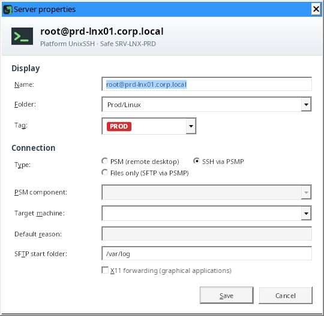

Without a PSMP in the Settings, the SSH and files-only types are greyed out, as elsewhere; an incorrect value
is reported in the window. A server whose account is not found in CyberArk (deleted or access removed) shows
"⚠ not found in CyberArk", which screen readers read too; nothing is flagged while the accounts are loading.

### Tags (PROD, QA, DEV…)

Each server of "My servers" can carry an environment tag, with a color: PROD in red, QA in blue, DEV in green at
first. It reminds you at a glance where you work:

- a chip before the name in the "My servers" tree and in shared lists;
- a chip on the session tab (and `[PROD]` at the start of the title of a detached window);
- a frame of its color around the SSH terminal or the files session (the name stays on the tab, taking no room
  from the terminal); a chip in the header of each pane of the parallel view and in that of the Files tab: you see
  which environment you drop a file on.

A session opened from "Available" or the recent sessions takes the tag of the "My servers" server that has the same
account (and the same target machine). The tag applies when the session opens: change it, then reopen the session to
see the new color.

- **When adding** a server to "My servers", the tag is asked in the same window as the folder (and the server
  of a domain account); it follows the folder and the server you type until you pick one yourself. A tag is suggested from the server name, its address,
  its safe, then its folders ("prd", "prod", "production" → PROD; "rec", "recette", "qual", "uat", "preprod",
  "staging", "test" → QA; "dev" → DEV; a tag added in the Settings is recognized by its name). Nothing is suggested
  when the text names two environments. Check it: it is only a suggestion. "No tag" is possible; "Cancel" does not
  add the server.
- **Change**: right-click a server or a selection (`Ctrl+click`) → "Tag ▸", or a folder → "Tag the servers of the
  folder ▸", then the tag, or "No tag". "Suggest from the name" tags at once the servers that have none yet (those
  without a suggestion stay untagged). Also in "Properties…".
- **List of tags**: Settings › My servers › "Server tags" (name of 16 characters at most, color; 20 tags at most).
  Renaming a tag renames it on the servers; deleting it removes it from the servers.
- The tag follows the server in the export of "My servers" and in shared lists; a tag missing from your Settings is
  shown in gray. The list of tags (names and colors) is shared with the team by the
  [environment file](#shared-environment).

### Export, import, share

Two menus at the top of the tab, "Import ▾" and "Share ▾", left of the "New folder", "Properties / rename" and
"Remove the server or delete the folder" buttons (`Tab` reaches these buttons, the arrow keys move from one to the
other):

- **Share › Export My servers to a file…** saves "My servers" to a `.json` file: folders (even empty ones), name, CyberArk account (ID), tag, connection
  type, component, target machine, default reason, SFTP start folder. No password and no followed file. Handy to move
  to another computer or to pass your list on.
- **Import › ZillaTerm file (export of My servers)…** reads an exported file (or a shared list) and sums up before
  adding: servers added, servers already
  there (same account, type, component, target machine and folder: skipped), folders created, servers opened on a
  target machine (check them: the machine comes from the file). Nothing is removed or changed in "My servers". A file
  created for another PVWA is refused: its account IDs designate other accounts there.
- **Import › Sessions of another tool…**: see [below](#bring-in-the-sessions-of-another-tool).
- **Import › Add a KeePass database…**: see [7.](#7-emergency-access-outside-cyberark-keepass-databases)
- **Shared lists**: a list of servers in a file on a network share, which the whole team opens and completes.
  - "Share › Create a shared list…": choose the location (network share) and the name shown to everyone; "Import ›
    Open a shared list…": add a list created by a colleague. Open lists are shown at the top of the tab (after the KeePass databases),
    with their folders; the search filters them too.
  - **Add**: right-click a server or a folder of "My servers" → "Share in a list" (the folder is kept), or drag a
    server, a folder or an account of "Available" onto the list or one of its folders (confirmation). The default
    reason stays personal: it is never shared.
  - **Remove**: right-click → "Remove from the shared list…" (or `Del`), after confirmation. During a search,
    "Remove the folder" removes all its servers, including those the search hides: the confirmation says how many.
  - **Use**: double-click to connect; right-click for the advanced options, the password, the safe members or
    "Copy into My servers". Everyone connects with their own CyberArk rights: an account you cannot see in the
    CyberArk Vault shows "⚠ not found in CyberArk". The tooltip shows the account as CyberArk describes it, the target machine, who added the server
    and when.
  - **Target machine**: a shared server that opens a domain account on a machine not among the account's allowed
    machines in CyberArk asks for confirmation on the first connection (anyone with write access to the share can
    change the list). "Copy into My servers" names such servers and asks before copying them.
  - **List of another PVWA**: a list created for another CyberArk Vault is shown, but its servers neither open nor get
    copied, and nothing can be added to it: sign in to that PVWA to use it.
  - **History**: right-click → "History of changes…". The "Changes" tab lists who added, removed or restored what,
    and when; the "Versions" tab keeps a copy of the list at each revision (the last 100, in the `name.versions` folder
    next to the file). On that tab, "Restore this version…" puts the list back in that state for everyone, after
    confirmation; the restore is itself recorded, so it can be undone.
  - Everyone's changes add up: the file is re-read and changed exclusively (a computer writing at the same time waits
    for its turn), and the list shown updates when a colleague changes it (`F5` re-reads it too). "Close the list"
    removes it from your tab without touching the file.
  - Rights: those of the network share. Read-only, the list can still be used but not changed.

### Bring in the sessions of another tool

To move to ZillaTerm without typing your servers again, and stop connecting to them directly: "Import ▾" menu ›
"Sessions of another tool…" at the top of the tab, or **Settings** menu › "Import sessions from another tool…". The PVWA accounts must be loaded.

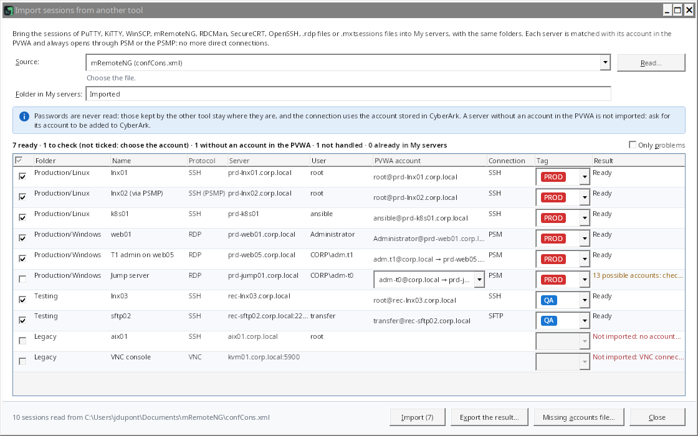

1. **Source**: choose the tool, then "Read…".

   | Source | Read from |
   | --- | --- |
   | PuTTY, KiTTY, WinSCP | your Windows registry, directly |
   | Registry export (`.reg`) | the PuTTY and KiTTY sessions and WinSCP sites it holds (exported from another computer, for instance) |
   | KiTTY portable | the KiTTY folder (`Sessions` subfolder, one file per session) |
   | WinSCP | the `WinSCP.ini` file (portable version) |
   | `.mxtsessions` or `.ini` file | its session sections, with their folders |
   | mRemoteNG | `confCons.xml`; a fully encrypted file is refused: export the connections without that encryption |
   | Remote Desktop Connection Manager | the `.rdg` file (groups, inherited credentials or credential profiles) |
   | SecureCRT | the configuration folder (`Config\Sessions`) or the XML export of the settings |
   | OpenSSH | the `config` file (`%USERPROFILE%\.ssh\config`): each `Host` without wildcard, settings taken the way `ssh` does |
   | Remote Desktop files | a folder of `.rdp` files and its subfolders |

2. **Matching**: each session is matched with a PVWA account.
   - Account of the server itself: same name, or short and full name (`srv01` and `srv01.corp.local`); with the same
     user when one is given. No DNS lookup: only names count.
   - Of a suitable type: Windows for Remote Desktop, Unix or network for SSH; another type only when there is none;
     never a database account.
   - Otherwise, a domain account of the same user (`CORP\admin`, `admin@corp.local`) allowed on that server: the
     server becomes its target machine. `CORP\admin` never means the local `admin` account of the server. Accounts of
     the server's domain come before the others; a session with no domain given that only finds an account of another
     domain (`admin@corp.local` for `web01.dmz.local`) only gets it as a suggestion, not ticked: "Account from another
     domain than the server: check it".
   - A session that already went through the PSMP (`vault@target@server@psmp`) or through PSM (start program
     `psm /u account /a server /c component` of an `.rdp` file) is decoded: the target account and server are what
     count, and the PSM component is kept.
   - Several possible accounts: the most likely one is proposed ("to check"), but the session is not ticked; choosing
     an account in the list of the "PVWA account" column ticks it (or tick it to keep the proposed one). The
     "Import (n)" button shows how many sessions will be added. The header box ticks the rows shown (those of the
     "Only problems" filter when it is ticked), or unticks them if they all are; it is half filled when only some are
     ticked.
3. **Saved connection**, never direct: Remote Desktop through PSM; SSH and files (SFTP, SCP) through the PSMP when
   there is one for that server (files only for an "SFTP" platform), otherwise through PSM (`PSM-WinSCP` for files);
   Telnet through `PSM-Telnet`.
4. **Folder in My servers**: the folders of the other tool are recreated under this folder ("Imported" by default;
   empty: at the root), each server keeping its name.
   **Tag**: the "Tag" column suggests the tag of each session from its name, its server, the safe of the matched
   account, then its folders in the other tool ("Prod/Linux" → PROD, "Recette" → QA), as
   [when adding a server](#tags-prod-qa-dev); empty when nothing is recognized. Change it if needed before importing;
   it is also in the exported result.
5. **Import** adds the checked, ready sessions. The table then shows the result for each server: "Imported", or "Not
   imported" with the reason (no account in the PVWA, connection type not handled such as VNC, FTP or serial port,
   unchecked). A server already in the same folder with the same account is not added twice. "Only problems" filters
   the table.
6. **Export the result…** saves this table as CSV (Windows regional separator): the list of servers without an
   account, to have added to CyberArk.
7. **Missing accounts file…** saves the accounts to create for the servers left without an account, ready for
   "Import accounts (CSV)" ([section 2](#2-find-an-account-available-tab)): one line per server and user for a local
   account (platform `WinServerLocal` for Remote Desktop, `UnixSSH` for SSH and SFTP), one line per domain user
   (platform `WinDomain`, the servers in the allowed machines). Fill in the safe, check the platforms (names of your
   Vault), then import it. No password in it.

No password is read, neither in the registry nor in the files: only the server, port, protocol, user and folder are.
The passwords kept by the other tool stay where they are: once the migration is done, delete them from that tool so
CyberArk is no longer bypassed.

## 7. Emergency access outside CyberArk: KeePass databases

When CyberArk is unavailable, ZillaTerm opens your KeePass databases (`.kdbx`) and connects **directly** to the
servers, over SSH, remote desktop or VNC, or to their files only (SFTP, FTP, FTPS), with the accounts they hold.

> These connections **do not go through the PSM**: no recording, no CyberArk rules. Every database opening,
> connection and change is written to the local log `%APPDATA%\ZillaTerm\urgence.log`.

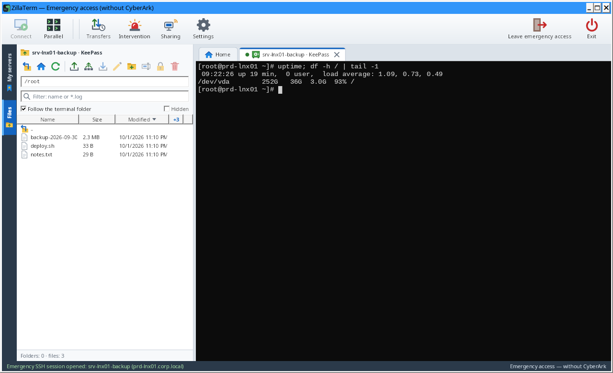

- **Without CyberArk**: on the sign-in screen, "Emergency access (KeePass)" opens the main window without the PVWA
  (only the KeePass databases are shown; the "Available" tab and the buttons specific to CyberArk are hidden; "Leave
  emergency access" locks the databases and goes back to the sign-in screen). With
  CyberArk, the databases also appear at the top of "My servers". The tooltip of a session tab opened from a
  database says so: "Direct emergency access (KeePass): outside CyberArk, written to urgence.log".
- **Add a database**: "Import ▾" menu › "Add a KeePass database…" of the "My servers" tab (safe button in emergency
  access), or right-click in the tab → "Add a KeePass database…". The "Add a
  KeePass database" window reminds you in a banner that these connections are outside CyberArk; "Browse…" picks the
  `.kdbx` file, then the name and an optional key file.
- **Unlock**: double-click the database. Master password and/or key file (every KeePass format). "Remember the
  master password in the local vault" saves typing it again (see below).
- **Connect**: double-click an entry. The protocol comes from its address (`ssh://server:22`, `rdp://server`,
  `vnc://server`, `sftp://`, `ftp://`, `ftpes://`, `ftps://`, or `server:3389`), a "Protocol" / "Port" field or a
  tag (`ssh`, `rdp`, `vnc`, `sftp`, `ftp`, `ftpes`, `ftps`); otherwise ZillaTerm asks for the protocol. The
  entry's password is used directly; it is never shown or written to disk.
  - **SSH**: terminal + Files tabs. On the first connection, the fingerprint of the server key is to be compared
    with the one given by its administrator, in the same window as for the PSMP (see
    [section 4](#4-open-an-ssh-session-through-the-psmp)). The entry's password is only sent once per connection: an
    outdated password in the database does not count several failures on the server (risk of locking the account),
    and "Cancel" cuts the connection without sending anything.
  - **Remote desktop**: tab with the FreeRDP client embedded in ZillaTerm (failing that, the Windows Remote Desktop
    control, which also offers "Full screen", `Ctrl+Alt+Break` to come back), with "Disconnect" and "Reconnect".
    Before each connection, ZillaTerm reads the server's certificate. If Windows does not trust it (self-signed…),
    its subject, its issuer, its dates and its SHA-256 fingerprint are shown on the first connection, then it is
    remembered for that server; if it changes later, the remembered and the new fingerprints are shown, and you must
    tick "I confirmed this change with the server's administrator". The password is only read after this check;
    FreeRDP receives it on its standard input (never on the command line) and only accepts the checked certificate.
    An entry without a password fails authentication. A server that does not accept TLS encryption is refused. No
    image of the session is kept on the computer's disk, including in Remote Desktop Connection opened when ZillaTerm
    has no client (the password must then be typed there).
  - **VNC** (`vnc://server`, port 5900; `vnc://server:1` means display 1, port 5901): desktop in a tab, fitted to
    the window or at real size ("Fit"), "Ctrl+Alt+Del" (after confirmation: depending on the machine, it opens the
    security screen or restarts some virtual machine consoles), "Send clipboard" and "Copy remote text" buttons: the
    clipboard is only exchanged through these buttons. VNC password authentication (8 characters at most, a limit
    of the protocol) or no authentication. **VNC encrypts nothing**: a banner says so; keep it for a trusted
    network. Before the VNC password is first sent, ZillaTerm asks for your agreement ("Send the password and
    connect", once per tab, reconnections included): VNC does not check the identity of the server, and a fake server
    or an interceptor can recover the first 8 characters of the password. Server beeps are limited to one per second.
  - **Files** (`sftp://`, `ftp://`, `ftpes://` for FTP with explicit TLS, `ftps://` for implicit TLS, port 990): a
    status tab, without a terminal, and the files in the "Files" tab with the same functions (transfers checked by
    SHA-256, queue, history, editor, compare, live follow, permissions if the server accepts `SITE CHMOD`).
    Right-click → "Open the files (SFTP, FTP)" does the same for an SSH entry, over SFTP. With `ftp://`, TLS
    encryption is tried first; if the server does not offer it, ZillaTerm asks before connecting in clear text
    ("Connect without encryption", once per session) and a banner reminds you. `ftpes://` and `ftps://` never fall
    back to clear text. An FTPS certificate that Windows does not trust (self-signed…) is shown with its subject, its
    issuer, its validity dates and its SHA-256 fingerprint (with "Copy"), then remembered for that server if you
    accept it; if it changes later, the remembered and the new fingerprints are shown, and you must tick "I confirmed
    this change with the server's administrator". A server that has already encrypted a connection is remembered:
    if it later comes without TLS (which an interceptor can cause), it is no longer the plain question but the "This
    FTP server no longer offers encryption" warning, which only lets you continue after ticking "I confirmed with the
    server's administrator that encryption was removed"; otherwise the connection stops without sending the password.
- **Edit the database**: right-click → "New entry…", "Edit…" (`F2`), "Delete" (`Del`, into the database's recycle
  bin, after confirmation). The server address is required: an entry without an address (neither in the Address
  box nor in its custom fields) is not saved. The rest of the database (attachments, fields, settings) is kept; the
  previous version of an entry goes to its history, like in KeePass. While saving, the previous version of the file
  is kept as `database.kdbx.bak`, then deleted as soon as the new file reads back identical: no old copy, which
  would still open with an old master password, stays next to the database (shared or not). Exception: if another
  computer saved the database at the same moment, its version is kept in the `.bak` rather than lost.
- **Lock**: right-click → "Lock". Databases also lock on sign-out of CyberArk, on exit and when **Windows is locked**.

**Local vault**: the master passwords you choose to remember are kept in `%APPDATA%\ZillaTerm\coffre-local.dat`,
encrypted with a password of your own (at least 8 characters) and tied to your Windows account. That password is
asked when you unlock a KeePass database whose password is remembered; "Later" (only offered at that moment) lets you
type the database password instead. If the local vault is not open, the database opens anyway, and the status bar
says its master password was not remembered. Manage it in the **Settings**, Security page: "Create…", "Unlock…",
"Change password…", "Delete now…"; these actions apply at once, without "Save". It locks on sign-out (so that
"Emergency access" never reopens the remembered databases without a password), on exit and when Windows is locked.

## 8. Intervention: recording and on-call duty reminder

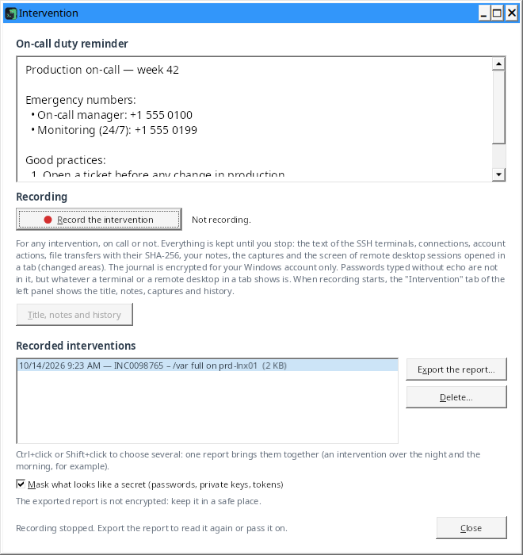 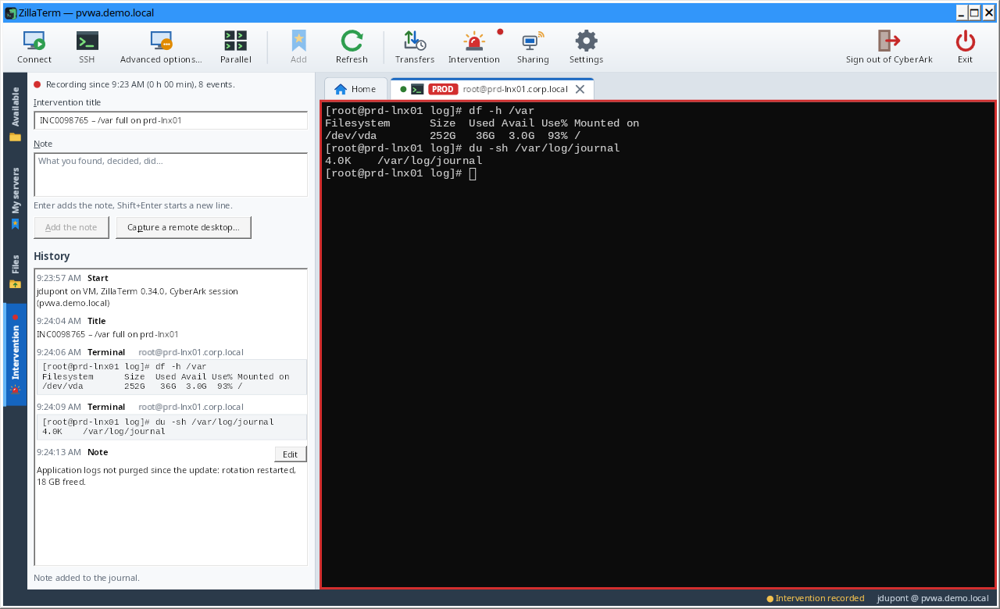

The **"Intervention"** button in the toolbar opens a window for any intervention, on call or not:

- **The on-call duty reminder**: good practices, emergency numbers, contacts… It comes:
  - from the text of **Settings › Intervention › Duty reminder**, shared with the whole team by the
    [environment file](#shared-environment);
  - or from a **text file** set in **Settings › Intervention › Reminder file** (usually on a network share; it can also be
    shared by the environment file). It is read again each time the window opens: the managers update it without
    sending a new environment. Its path shows under the title; if it cannot be read (missing, access denied, share not
    answering within 5 seconds), the text from the Settings is shown, with the reason. UTF-8 or UTF-16 (Notepad is
    fine); only the first 64 KB are read.

  It shows as plain text (selectable to copy a number): no link or formatting is interpreted, and the invisible
  characters of a file (which could reverse the order of the digits of a number) are removed.
- **"Record the intervention"**: from then on, ZillaTerm keeps everything that happens, until "Stop recording" (or "End
  the intervention" in the Intervention tab) or until ZillaTerm closes. Recording goes on after signing out of CyberArk
  and in emergency access. A red dot on the button and "● Intervention recorded" in the status bar remind you of it.
  What is kept:
  - the **text of the SSH terminals** (commands typed and their output, line by line, with the time; not the screen
    of vim, less or top, nor the command ZillaTerm types itself to follow the folder);
  - **connections**: SSH, files, remote desktop and VNC sessions opened, failed and closed, and PSM sessions with
    the component, target machine, reason and ticket;
  - **actions**: password copied (never the password), CPM requests, accounts added, changed, deleted or imported,
    X11 windows, switch to emergency access, sign-out;
  - **file transfers**, with the SHA-256 of each file;
  - the intervention **title** and your **notes** ("Intervention" tab, below);
  - **captures**: "Capture a remote desktop…" ("Intervention" tab) takes an image of a Remote Desktop Connection window
    (PSM sessions; a minimized window cannot be captured), and the "Capture" button of ZillaTerm's remote desktop tabs
    takes the desktop shown;
  - the **screen of remote desktop sessions opened in a tab**, the way the RDP protocol sends it: the tab shown is
    captured every second and only the changed areas are kept (64 × 64 pixel squares in 16-bit colour, compressed; an
    area already seen, like a menu that comes back, is kept only once). "● Screen recorded" in the tab bar reminds you.
    A tab in the background, a minimized window and full screen are not captured; back on the tab, whatever changed in
    the meantime is kept. A small isolated change (a character typed) is kept once the screen has not moved for 3
    seconds, at the latest after a minute; a still screen costs nothing. Beyond **100 MB of journal**, the screen is
    kept only once every 10 seconds: the journal notes it, the "Intervention" tab says so and the indicator becomes "●
    Screen recorded (every 10 s)". A session opened with Remote Desktop Connection (mstsc) is not recorded this way:
    only a capture keeps it.
- **"Intervention" tab of the side panel** (`Ctrl+4`): it appears when recording starts, with a red dot while recording
  lasts: title, notes and history stay next to the session. Opening an SSH session does not replace it with the "Files"
  tab. A click on "● Intervention recorded" in the status bar or on **"Title, notes and history"** in the Intervention
  window brings it back. It holds:
  - the **intervention title** (ticket, incident, server…), kept with `Enter` or when leaving the field: it is written
    to the journal, shown in the "Recorded interventions" list, at the top of the report and in the file name suggested
    for it. One line, 200 characters at most;
  - the **note**: `Enter` adds it to the journal, `Shift+Enter` starts a new line. **"Edit"** on a note of the history
    (or `F2`) brings it back into the field: `Enter` or "Save the change" replaces it in place, `Esc` or "Cancel" gives
    back what you were typing. The note then shows "edited at …"; the journal keeps the original text and the report
    shows both. Only the notes of the current recording can be edited;
  - **"Capture a remote desktop…"**;
  - the **history** of the intervention, as it happens: start, title, notes, connections, actions, transfers (with their
    SHA-256), captures and terminal text. A command and its output form a block (a new block starts after 2 seconds
    without output); a block of more than 8 lines is reduced to its first 6, and **"Show all (N lines)"** expands it in
    full (selectable text), "Collapse" folds it back. `Ctrl+C` copies the selected event. The list follows new events
    while it is at the bottom. The history is kept in memory only; its terminal text is limited to 8 million characters
    (beyond that, a message says so, and the text is still in the report).

  **"■ End the intervention"**, at the bottom of the tab, stops the recording after a confirmation (`Enter` confirms,
  `Esc` or "Keep recording" cancels); a note being typed is added to the journal first. When recording stops, from here
  or from the Intervention window, the tab goes away and the Intervention window shows the intervention in "Recorded
  interventions", ready for "Export the report…".
- **Timed reminders** (Settings › Intervention, or the team's environment file): one line per reminder, the minutes since the
  start of the recording then the text ("30 Escalate to level 3"), 10 at most. The status bar shows the next one ("●
  Intervention recorded · Escalate to level 3 in 12 min"); at that time a banner appears at the top of the
  "Intervention" tab, the status bar says it and the ZillaTerm button flashes in the taskbar, without taking the
  keyboard (what you are typing does not go elsewhere). The reminder is noted in the journal, and **"Got it"** notes
  that you saw it.
- **ZillaTerm stopped during the recording** (crash, PC restarted): at the next launch, within 12 hours, ZillaTerm
  offers **"Resume the recording"**: what follows is added to the same journal (title, history and reminders carried
  over; a single report), after an event that says who resumed and since when nothing was kept. **"Close the
  intervention"** ends it as it is (its duration does not change); **"Later"** leaves it, and the question comes back at
  the next launch.
- **"Recorded interventions"**: the list of recordings, newest first, with their title. When you stop, the intervention
  stays selected: **"Export the report…"** (or double-click) turns it into an HTML page: summary, timeline, blocks of
  terminal text and captures, to attach to the intervention report. Each recorded screen has its own player: "Play",
  "Speed" (1× to 60×) and a position slider, under which a graph shows the screen activity (share changed at each
  moment): click a peak to go there. The notes are placed there at their time (orange marks): click one to go there,
  hover it to read it; the timeline runs until the last trace of the session (tab closed…), so a note taken in front of
  a still screen is on it. The display pauses (tab in the background, ZillaTerm minimized, Windows locked: the server no
  longer sent the picture) are grey bands there, from their start to their end, with their reason on hover: click one to go there, and
  the frozen screen then shows "Display paused". The player is the only script of the page, allowed by its hash; it
  needs a recent browser
  (Edge, Chrome, Firefox). A missing image (damaged journal) freezes the screen until the next full image, with a
  notice. **"Delete…"** erases a finished recording.

  Several interventions chosen together (`Ctrl+click`, `Shift+click`) make **a single report**: their events one after
  the other and, at the top, the list of recordings (an intervention over the night and the morning, for example); they
  are also deleted together. **"Mask what looks like a secret"** (checked by default) replaces in the report, with
  "[masked]", passwords (`password=…`, `"client_secret": "…"`, `--db-password=…`, the one in an address
  `https://jdoe:…@srv01.corp.local`; a password starting with `$` or `%` too, unless it has the shape of a variable,
  left readable: `$DB_PASS`, `${VAULT_PASS}`, `$(cat …)`, `%DB_PASS%`), the body of private keys (`-----BEGIN … PRIVATE KEY-----`), `Bearer` and `Basic`
  headers, tokens of known formats (JWT, GitHub, GitLab, Slack, AWS, Google) and password hashes (`$6$…` from
  /etc/shadow); the report says how many passages were masked. Images (captures, recorded screens) are not masked, and
  the encrypted journal keeps everything. Masking is a safety net: read the report again before passing it on.

The journal is **encrypted for your Windows account only** (DPAPI) in `%LOCALAPPDATA%\ZillaTerm\Interventions` (the
title too, in a `.title` file next to it, for the list), block by block as recording goes, its text compressed (a crash
only loses the last two seconds, and the report says so). A block removed, moved or changed is reported. ⚠ Passwords
typed without echo are not in it, but **whatever a terminal or a remote desktop in a tab shows is** (the contents of a
configuration file, for example); the exported report is **not encrypted**: keep it in a safe place. Terminal text is
capped at 64 million characters per intervention (the other events are still kept beyond that); a very large output is
written in several blocks, without losing the rest of the report. A disconnection cancelled at the confirmation is not
in it.

**Disk refusing the journal** (full, quota, access removed): the status bar shows "⚠ Intervention: recording
interrupted" in red, and the window "Recording interrupted at 14:10.": nothing more is kept from that time on, the
title, the note and the capture are greyed out in the "Intervention" tab. Free some space, then "Stop recording" and
"Record the intervention" to start again in a new recording.

## 9. Share a session with a colleague

Show a session live (SSH terminal, Remote Desktop in a tab, VNC) to another person who has ZillaTerm, and watch
theirs: to get help, train someone or work together during an intervention. Several sessions can be shared at once,
several people can watch the same one, and one ZillaTerm can share and watch several sessions at the same time.

**Turn it on**: Settings › Sharing › "Allow sharing my sessions with another ZillaTerm" (off by default; watching
another person's session works without it). Then, how others reach you:

- **Direct connections to this computer**: the other ZillaTerm connects to your computer (a free port chosen at
  random, or a fixed port). The first time, Windows Firewall may ask to allow ZillaTerm: allow it on private or domain
  networks only.
- **Relay folder**: a folder of a network share that both computers can reach (`\\server\share\folder`), used when
  the direct connection does not get through (firewall, VPN). The person joining tries the direct connection first,
  then the folder. When the invitation offers a relay folder that is not the one in their Settings, ZillaTerm shows it
  and asks before using it ("Go through this relay folder?"): Windows connects to it with their account, so it should
  only be the team's relay folder.

**Share a session**

1. Right-click the session tab (or in the terminal) → "Share the session…".
2. Choose the duration (15 minutes to 4 hours) and, for a terminal, "Allow giving control". Then "Start sharing".
3. Send the invitation (`zillaterm-share:1:…`, "Copy the invitation" button) to the person through the company chat.
   The invitation only lets them **ask**: nothing is shown without your agreement.
4. When the person uses it, a banner above the session says "Paul Martin (CORP\pmartin, computer PC-PMARTIN) asks to
   watch", and the window flashes in the taskbar. "Answer…" shows a **6-digit verification code**: the person sees the
   same one on their side. Compare it with them (phone, chat), tick "I checked the code with this person", then
   "Accept". A different code means someone else is in between: refuse. Without an answer, the request expires after
   3 minutes.

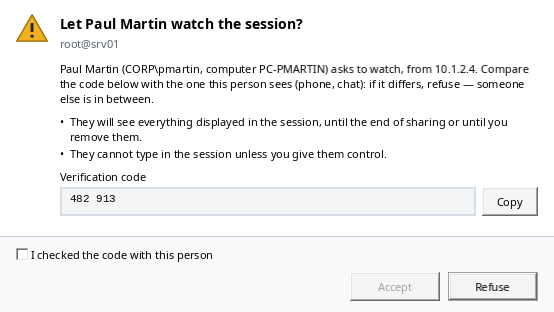

While the session is shared, its banner says who is watching, who has control and until when, with "Manage…" and
"Stop sharing"; the status bar counts the shared and watched sessions and the waiting requests.

**Give control** (terminal only, if the share allows it): the person clicks "Ask for control"; in the banner, "Give
control…" then confirm. What they type goes into your session **under your identity** (the PSMP and the server record
it in your name): stay in front of the session. "Take back control" makes everyone read-only again. One person has
control at a time. Remote Desktop and VNC are always read-only.

**Watch another person's session**: "Sharing" toolbar button → "Join a shared session…", paste the invitation (the text
around it in the message does not matter), then "Join". Give the person the code shown and wait for their agreement:
the session opens in a tab. The terminal keeps the size of the sharer's terminal, enlarged or reduced to fit the tab;
nothing you type is sent until you have control. With control, an orange banner reminds you; "Give control back"
returns to read-only. When sharing ends, the tab says why (stopped, time up, computer locked, connection lost…) and
keeps the last image.

**Manage**: "Sharing" toolbar button (or click the status bar indicator): your shared sessions and their people
(answer, give or take back control, remove, show the invitation again for someone else, stop), and the sessions you
watch (show, leave).

**Sharing stops** at the end of its duration, when you stop it, when the session or its tab closes, when **Windows
locks**, when you sign out of CyberArk and when ZillaTerm closes. A Remote Desktop session is shown only while its tab
is displayed (not in full screen, window not minimized): otherwise the image stays frozen for the person watching, who
is told so.

While an [intervention](#8-intervention-recording-and-on-call-duty-reminder) is recorded, the journal notes the start
and end of each share, each request (computer and address), each agreement (with the code checked), refusal, departure
or removal, control given and taken back; on the guest side, the session watched and control received.

⚠ Everything displayed in the shared session is visible to the accepted people: do not display passwords or secrets
while sharing.

## Shortcuts

| Where | Action | Shortcut |
| --- | --- | --- |
| Outside the terminal and the Files tab | Reload the accounts from the PVWA | `F5` |
| Outside the terminal | Filter the accounts (in "My servers": search a server; in "Files": filter the folder) | `Ctrl+F` |
| Everywhere | Next / previous session tab | `Ctrl+Tab` / `Ctrl+Shift+Tab` |
| Everywhere | Close the session tab | `Ctrl+F4` or `Ctrl+Shift+W` |
| Everywhere | "Available", "My servers", "Files", "Intervention" tabs of the side panel | `Ctrl+1`, `Ctrl+2`, `Ctrl+3`, `Ctrl+4` |
| Everywhere | Settings | `Ctrl+,` |
| Outside the terminal | Quick connect (Home tab) | `Ctrl+K` |
| Outside the terminal | Move from the side panel to the session and back | `F6` |
| Outside the terminal | Collapse / expand the side panel | `Ctrl+B` (or double-click the splitter) |
| Lists and trees | Open the session | Double-click or `Enter` |
| Lists, trees, tabs | Right-click menu | Menu key or `Shift+F10` |
| Search | Clear the filter | `Esc` or ✕ at the end of the box |
| Home | Remove a recent session from the list | `Del` |
| My servers | Rename / remove or delete | `F2` / `Del` |
| My servers | Pick several servers (then right-click to open them together) | `Ctrl+click`, `Shift+click`, `Ctrl+Space`, `Shift+↑` / `Shift+↓`; `Esc` cancels |
| Intervention | Edit the note selected in the history | `F2`, then `Enter`; `Esc` cancels |
| Terminal | Copy | Mouse selection, or `Ctrl+Shift+C` |
| Terminal | Paste | `Shift+Insert` or `Ctrl+Shift+V` (right-click with the Settings option) |
| Terminal | Menu: copy, paste, select all, search, save, clear the history, font size, tab actions | Right-click or Menu key (Shift+right-click with the paste option) |
| Terminal | Scrollback | Mouse wheel, scroll bar, `Shift+Page Up` / `Shift+Page Down`; "↓ Back to the end" |
| Terminal | Search (history included) | `Ctrl+Shift+F`, then `Enter` / `Shift+Enter` |
| Terminal | Save the content to a file | `Ctrl+Shift+S` |
| Terminal | Font size / default size | `Ctrl+wheel` / `Ctrl+0` |
| Comparison | Next / previous difference | `F7` / `Shift+F7` |
| SSH or remote desktop tab | Close | Tab cross or middle click |
| SSH or remote desktop tab | Reconnect, duplicate (another session on the same account or entry), detach (SSH), close, close the other tabs | Right-click on the tab |
| SSH tab | Detach to a separate window (another screen) | Drag the tab out of the window |
| SSH tab | Add to the parallel view, or take it out | Right-click the tab |
| Remote desktop | Full screen / back | `Ctrl+Alt+Break` |
| Files | Open the folder or edit the file / edit / rename / parent folder / delete / refresh | Double-click or `Enter` / `F4` / `F2` / `Backspace` / `Del` / `F5` |
| Files | Sort by a column, then reverse | Click its header |
| Files | Go to the item whose name starts with these letters (the same letter again: the next one) | Type the start of the name |
| KeePass database | Connect / edit / delete an entry | Double-click or `Enter` / `F2` / `Del` |

In a terminal, `F5`, `Ctrl+F`, `Ctrl+K`, `Ctrl+B` and `F6` are sent to the server (`F6` to applications such as
mc); `Ctrl+Tab`, `Ctrl+F4`, `Ctrl+Shift+W` and `Ctrl+1/2/3/4` stay with ZillaTerm. In a remote desktop session, the keys
go to the remote session.

**Keyboard and accessibility**: the toolbar can be reached with `Tab` (the focus is visible), every menu and every
window has its access keys (`Alt` + underlined letter, without duplicates, in English, French and Italian), and the
menu of an item of "My servers" opens at the same place with a right-click, `Shift+F10` or the Menu key. Password
boxes (sign-in, KeePass database, local vault) warn when Caps Lock is on. Screen readers announce the names of list
and tree items, of icon or symbol buttons (✕, ↑, ↓), of fields (path, ticket number…), each button and each box by
its label, the status bar messages and connection errors; a refused password is announced with the attempt number
("Attempt 2 of 3"), also read with the field, and a server that no longer responds or an ended session is announced
only once. On the selected row of trees and tables, the secondary texts (counters, "matches: …", ⚠) stay readable,
with or without the focus. The toolbars of "My servers" and of the Files tab are a single `Tab` stop (the arrow keys
move from one button to the other). In the Settings, every box has its access key, without duplicates in the page
shown, and the "Team" badge is read with its tooltip. In high contrast mode, the interface takes the Windows system colours and follows their changes.

**Dark theme**: Settings › General › Theme: "Same as Windows" (default: the app mode chosen in Windows,
Personalization → Colors, followed even when it changes), "Light" or "Dark". The change applies right away, to open
windows and to the title bar; Windows high contrast always takes precedence. SSH terminal colours are set separately
(Terminal page).

## Settings and configuration file

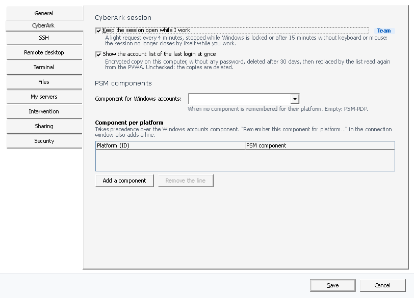

Settings toolbar button → "Settings…" (or `Ctrl+,`). The window, which can be resized, has one page per topic (on the
left, `Ctrl+Tab` from one to the next): General, CyberArk, SSH, Remote desktop, Terminal, Files, My servers,
Intervention, Sharing, Security; each fits on one screen. Every setting has its help line underneath; "⚠" there marks
a real risk. "Save" applies the settings; an incorrect value shows the page of the field concerned, with the cursor in
it.

**"Team" badge**: on the right of a setting, it means that the team's [environment file](#shared-environment) (next to
the executable or central file) sets it, with the value in effect; its tooltip gives the file. You can still change the
setting here, but a new version of the file may change it (always after your approval). A setting you refused at
import, or changed since, has no badge.

| Page | Setting | Purpose | Default |
| --- | --- | --- | --- |
| General | Interface language | Français, English, Italiano or system language; applied after signing out of CyberArk or at the next start | Windows language (English if it is not translated) |
| General | Theme | Same as Windows, Light or Dark; applied right away (Windows high contrast takes precedence) | same as Windows |
| General | Confirm before closing a connected session | SSH, remote desktop, VNC; "Don't ask again" in the confirmation unticks this setting | yes |
| General | Look for a new version at startup | One request to GitHub at most once a day; a link in the status bar when a newer version exists (the "About" window recalls this setting) | no |
| General | Central file | Team environment file on a network share, read at each start; its changes are shown before being applied (see [Shared environment](#shared-environment)) | empty |
| General | Debug log | How connections unfold, in a file, without secrets (see [Security](#security)); "Show the file" opens it in Explorer. Also in the Settings button menu | no |
| CyberArk | Keep the session open while I work | Light request every 4 minutes while you use the computer; paused while Windows is locked or after 15 minutes without keyboard or mouse (the CyberArk session then expires after its idle timeout) | yes |
| CyberArk | Show the account list of the last login at once | Encrypted copy (Windows account) of the last complete list, one per PVWA and user, without any password, deleted after 30 days: shown at once, then replaced by the list read again from the PVWA. Unchecked: the copies are deleted | yes |
| CyberArk | Component for Windows accounts | PSM component of Windows accounts (domain or local) without a component remembered for their platform, for example `WIN-PSM` | empty = `PSM-RDP` |
| CyberArk | Component per platform | Platform (PVWA ID, for example `WinDomain`) / PSM component table: "Add a component", "Remove the line", editable cells; takes precedence over the component for Windows accounts. "Remember this component for platform" (connection window) adds a line to it | empty |
| SSH | Open SSH sessions in ZillaTerm | Built-in terminal and Files tab; unchecked: Windows Terminal | yes |
| SSH | Default PSMP, port | PSM for SSH server; when set (or a PSMP by domain), Unix accounts open over SSH by default (as files only for an "SFTP" platform); without any PSMP, SSH and SFTP are disabled | empty, 22 |
| SSH | PSMP by domain | Other PSMPs (address, port, domain served); each server goes through the one of the domain closest to its own (see [PSMP by domain](#psmp-by-domain)); "Which PSMP for the server" to check | none |
| SSH | Let the Files tab follow the terminal folder | Adds a command to `PROMPT_COMMAND` of the remote shell when the session opens (see [Following the terminal folder](#following-the-terminal-folder)) | yes |
| SSH | Local X server | This computer's X server for X11 forwarding (`:0` = port 6000); this computer only | `:0` |
| Remote desktop | Open PSM Windows sessions in a ZillaTerm tab | PSM session (desktop or remote application) in a tab, with the built-in FreeRDP client, at the size of the tab (see [Open a PSM session](#3-open-a-psm-session-remote-desktop)); unchecked: Windows Remote Desktop Connection | no |
| Remote desktop | Resize the remote desktop with the tab | Sessions in a tab: the resolution follows the size of the tab instead of a scaled picture; the connection from the PSM to the target may keep its original size | yes |
| Remote desktop | Share this computer's drives | Asks the PVWA for this computer's drives ("Map local drives" box of its connection window, `AllowMappingLocalDrives`); when the component allows them, they appear in the session (File Explorer › This PC). ⚠ The programs of the session can then read and write your drives | yes |
| Remote desktop | Pause the display of sessions nobody is watching | Sessions in a tab: when the tab has been in the background, ZillaTerm minimized or Windows locked for 1 minute, or nobody has used the keyboard or mouse for 15 minutes, the server stops sending the picture; the session stays open, the picture comes back when you return to the tab or move the mouse. Never for the tab shown while an intervention is being recorded or the session is shared; during a recording, the pause of a tab in the background is marked in it (screen and timeline of the report) | yes |
| Terminal | Terminal colours, font size | Palette (Campbell, One Half, Solarized…) and font size of the SSH terminals; `Ctrl+wheel` changes the size of one terminal, `Ctrl+0` resets it | Campbell, 14 |
| Terminal | Warn before pasting several lines when the shell would run them one by one | Preview and confirmation before pasting | yes |
| Terminal | Right-click in the terminal pastes the clipboard | Shift+right-click then opens the menu; ⚠ a stray right-click sends the clipboard to the shell | no |
| Files | Upload protocol | Protocol tried first (SFTP or SCP); if the server refuses it, the other one takes over | SFTP |
| Files | Offer a single .tar.gz archive | Sending a single archive is offered from this number of files dropped at once | yes, 200 |
| Files | Follow files (tail -f) in an independent session | Following a file opens its own SFTP connection (one more PSMP session) | no |
| Files | Text editor | Program opened by "Edit" in the Files tab | Notepad |
| Files | Comparison tool | Program offered in the comparison window, with its arguments (`{0}` = left file, `{1}` = right file) | none |
| My servers | Server tags | Tags given to the servers of "My servers" (name, color): "Add a tag", "Remove the tag", editable cells; renaming follows in "My servers", deleting removes the tag from the servers (see [Tags](#tags-prod-qa-dev)) | PROD (red), QA (blue), DEV (green) |
| Intervention | Duty reminder | Good practices and emergency numbers shown at the top of the "Intervention" tab; plain text (see [Intervention](#8-intervention-recording-and-on-call-duty-reminder)) | empty |
| Intervention | Reminder file | Text file (usually on a network share) read again each time, shown instead of the reminder above | empty |
| Intervention | Timed reminders | One line per reminder: minutes since the start of the recording, then the text ("30 Escalate to level 3"); shown in the "Intervention" tab and the status bar, noted in the journal | empty |
| Sharing | Allow sharing my sessions with another ZillaTerm | Share a session from the menu of its tab; watching another person's session works without it (see [Share a session](#9-share-a-session-with-a-colleague)) | no |
| Sharing | Direct connections to this computer, port | The other ZillaTerm connects to this computer; port 0 = a free port at random, 1024 to 65535 for a fixed port (useful when the firewall must allow it) | yes, 0 |
| Sharing | Relay folder | Folder of a network share that both computers can reach, used when the direct connection does not get through; encrypted exchanges, deleted at the end of the share (a folder on a network server coming from the environment file requires ticking "I checked…") | empty |
| Security | Server keys and certificates | Table of the fingerprints checked and accepted (server, type, fingerprint): PSMP, direct SSH, FTPS and Remote Desktop certificates of KeePass entries (one row per key type); "Filter the servers" narrows the list. "Forget the selected keys" removes the selected rows on save; the key will be asked again at the next connection | — |
| Security | Local vault | Remembered KeePass master passwords: "Create…", "Unlock…", "Change password…", "Delete now…"; these actions apply at once, without "Save" | — |

The settings the team's environment file can spread are listed in [Shared environment](#shared-environment).

### Shared environment

To give ZillaTerm to a colleague with the team's configuration (PVWA address, sign-in method, default and by-domain
PSMPs, Windows accounts component and per-platform components, shared lists, PSMP keys, on-call duty reminder (text or
file), timed reminders, server tags, session sharing, a few options), with nothing personal and no password:

1. **Export**: "Settings" button → "Export the environment…" saves `ZillaTerm.env.json`.
2. **Next to the executable**: put this file next to `ZillaTerm.exe` (for example in the same zip). At start, when
   it is new or has changed, ZillaTerm offers it before the sign-in screen.
3. **Import**: "Settings" button → "Import an environment…", or "Import an environment…" on the sign-in screen.
4. **Central file**: Settings › General › "Central file" (a file on a network share, which can also be set in the
   environment itself). It is read at each start: when you change it, everyone sees the changes at their next start.
   An unreachable share (workstation off VPN) does not slow down the start: after 5 seconds the file is skipped and
   read again at the next start.

Each time, a window shows what will change ("old value → new value") and the SHA-256 fingerprint of the file; "Do not
apply" is the default. The PVWA and the PSMPs receive your CyberArk password: when the file changes their address or
adds a server key or a shared list on a network server (Windows signs in to it at each start; the server is named),
"I have checked…" must be ticked before applying. A server key already accepted on the computer is never replaced by a
file (it is reported). Only the keys of the PSMPs (those of the computer or of the file) are taken: the key of another
server, an emergency access one for example, is ignored and checked at its first connection. A key taken from a
file only applies to connections to the PSMP: a direct connection to the same server (KeePass) still has its key
checked. In Settings, these keys appear as `psmp://host:port`.
A file written in "UTF-8 with BOM" (PowerShell 5.1: `Set-Content -Encoding UTF8`) is accepted, like a shared list. An
invalid file (http address, wrong component name…) is refused as a whole. A file already offered is offered again
only when it has changed. A setting left empty on the exporting PC is
not exported: it clears nothing on the importing one. Paths (shared lists, central file) are full: `C:\…` or
`\\server\…`. Your user name, "My servers" and your
recent sessions are never touched; shared lists are added without removing yours. The tags of the file replace those
of the computer; your servers keep theirs (a tag missing from the file is then shown in gray). The timed reminders of
the file (`"InterventionReminders": [{ "Minutes": 30, "Text": "Escalate to level 3" }]`) also replace those of the
computer.

All preferences are saved in `%APPDATA%\ZillaTerm\settings.json`: language, PVWA address, sign-in method and user
name, the settings above, "My servers", their folders and the files followed on them (paths), recent sessions,
location of the KeePass databases and of their key files, and of the open shared lists, window position and size,
width and state of the side panel. This file contains **no password, token or private key**. To start from scratch,
close the application and delete `settings.json` and `settings.json.bak` (the backup alone would be used, with a
message); if the old `%APPDATA%\CyberArkTerm` folder still exists, delete or rename it too, otherwise its settings are
picked up at start-up. It is written to a temporary file first, then put in place,
the previous one being kept as `settings.json.bak`: if the file ever cannot be read, it is set aside (never
overwritten), the backup is used and a message says so. ZillaTerm opens only once per Windows session: two
instances would overwrite each other's settings. The transfer history of the Files tab is next to it, in
`transfers.json` (file names and paths, SHA-256 checksums, never their content).

### Moving from CyberArkTerm to ZillaTerm

CyberArkTerm is now called ZillaTerm. The first time `ZillaTerm.exe` starts, the `%APPDATA%\CyberArkTerm` folder
(settings, "My servers", local vault, transfer history, emergency access log) is copied to `%APPDATA%\ZillaTerm`; the
old folder is kept: delete it, along with `CyberArkTerm.exe`, once you have moved to ZillaTerm. A
`CyberArkTerm.env.json` file next to the executable is still read, shared lists stay readable by both versions and the
master passwords of the local vault stay available. The old temporary folder (`%TEMP%\CyberArkTerm`) is emptied over the
following starts (files older than one day). Both versions cannot be open at the same time. CyberArkTerm reports the
first ZillaTerm version but cannot download it itself (renamed repository): download it once from the releases page.

## Security

- **HTTPS required** to the PVWA; certificate validation is never disabled. The revocation of the PVWA certificate
  (and of GitHub's for updates) is checked online: a revoked certificate is refused; if the revocation list cannot be
  reached (closed network), the connection goes through after 5 seconds at most, and the debug log notes it; the
  result is kept for an hour. A redirection from the PVWA is never followed (your password would go to the address
  given): it is reported with that address. The PVWA address may only contain the server name, a port and a path: a
  "name@" before the server (which would reach another server than the one shown), a space, a "\" or a non-ASCII
  letter are refused.
- **File names from the server**: invisible characters (writing direction override, zero-width space, control
  characters) are shown as "�" in the list, the confirmations, the choice of a file of the other server, the
  comparison, the transfer queue and history, and when following a file (tail), and become "_" in the name of the
  downloaded file, so that a name cannot imitate another one (".exe" shown as ".pdf"). Files coming from the servers
  (downloads, copies opened in the editor, dragging to Explorer) carry the mark of files from the Internet (Internet
  zone; the server's name is never written in it, as Windows may send it to Microsoft): SmartScreen checks an
  executable before running it,
  and office applications open a document in Protected View. Special files (a device such as `/dev/zero`, a named
  pipe, a socket) are neither opened nor downloaded, and are skipped when a folder is downloaded.
- **No secret on disk**: CyberArk password, session token, MFA key and PSMP password stay in memory for the session.
  Kept PSMP passwords and the MFA key are forgotten when Windows locks; the MFA key is wiped after each connection and
  removed from the PVWA at logoff (`Logoff`), done on exit.
- PVWA session opened with `concurrentSession`: your PVWA web session, if any, is not closed.
- **Session sharing** (off by default): you start each share, and you accept each person after comparing a 6-digit
  code; nothing listens on the network while no session is shared. The invitation holds a random 256-bit secret, valid
  for the duration of the share, and only lets someone ask. Exchanges are end-to-end encrypted: ECDH P-256 key exchange
  authenticated by the invitation secret, then AES-256-GCM, one key per direction, numbered messages (an altered,
  replayed or moved message cuts the connection). The verification code is derived from the connection keys: someone
  in between, even with the invitation, would get another code. After 5 attempts with a wrong invitation, the share
  stops. The relay folder only sees encrypted messages, deleted at the end of the share; an invitation's relay folder that
  is not the one in your Settings is only used after you agree (Windows connects to it with your account). Nobody types in a session
  unless you gave them control (terminal only), and you take it back whenever you want; sharing stops when Windows
  locks. The name, account and computer of a person who asks are declarative: only the code is proof.
- **End of the Windows session** (sign-out, shutdown): ZillaTerm closes without asking; its sessions are closed
  (copies of edited files deleted), the KeePass databases and the local vault locked, the clipboard holding the
  password cleared and the PVWA session closed (2 seconds at most).
- **Copying a password**: the PVWA response is read into a buffer wiped afterwards and decoded without going through
  a string; the password goes straight to the Windows clipboard, marked to be excluded from the history (`Win+V`),
  from cross-device sync and from clipboard monitoring tools, then cleared after 20 s if it is still there (tried
  again every second if another application keeps the clipboard open), and on sign-out, exit and Windows lock. It is
  never shown nor written to the debug log. A response that is not the password (HTML maintenance page, redirect to
  an SSO sign-in page, empty response) is refused instead of being copied.
- **Importing the sessions of another tool**: only the server, port, protocol, user and folder are read, never a
  password; XML files are read without DTD or external resource, size limited. Each imported server opens through PSM
  or the PSMP with a PVWA account, never directly; a server without an account is not imported.
- **Adding an account**: the password is read from the masked box without going through a string, sent once to the
  PVWA over HTTPS, then wiped from memory; it is neither saved nor written to the debug log.
- **Temporary folder**: `%TEMP%\ZillaTerm`, reserved for your Windows account (permissions limited to you alone);
  if it belongs to another account (TEMP pointing to a shared folder), `%LOCALAPPDATA%\ZillaTerm\Temp` is used
  instead. The paths below are relative to this folder.
- **PSM sessions**: the PVWA's RDP file (one-time PSM token) is written to the temporary folder for `mstsc`, which
  checks its signature, then deleted after 60 s or on exit. In a tab (option), it is never written to disk: ZillaTerm
  reads it in memory and passes it to the FreeRDP client on its standard input (token absent from the command line
  and from the logs). The PSM certificate (or its key) is read and checked by ZillaTerm before the client is launched
  (trusted by Windows, pinned or confirmed); the client then accepts no other, shows no Windows window and reads no
  saved Windows credentials.
- **Simultaneous typing** (parallel view): off every time the view opens, shown by the amber "ON (n)" button, an
  amber banner and frame that name the sessions concerned; excluded sessions are marked "excluded", an added session
  is not included by default, and pasting several lines into several
  sessions asks first. Each session stays a separate PSMP session, recorded as usual.
- **Pasting several lines** into a terminal whose shell would run them one by one: preview and confirmation before
  sending (setting on by default).
- **Confirmations**: buttons with an explicit verb in the application language, "Cancel" by default, server, account
  or safe named; closing a connected session is confirmed (setting on by default).
- **File comparison**: contents read in memory and wiped when the window closes; only the copies given to an
  external tool go through the disk (temporary folder, `compare`), deleted when the window closes and at the next
  start.
- **New version**: no request to the Internet without your action or the Settings option (off by default); only the
  addresses of the project repository are followed, the archive is kept only when its SHA-256 checksum is the one of
  `SHA256SUMS.txt` of the same release (which detects an incomplete or damaged download, not a release published by
  someone who took over the repository), and nothing is installed or started. The kept archive carries the mark of
  files from the Internet ("Mark-of-the-Web"): SmartScreen checks the extracted executable. Since 0.30.0, the
  published archive has a provenance attestation, which proves that it was built by the project repository:
  `gh attestation verify ZillaTerm-<version>-win-x64.zip --repo muller-camille/ZillaTerm`.
- **PSMP host keys pinned** on first use: the fingerprint is to be compared before accepting ("Cancel connection" by
  default); a changed key is flagged by a banner and only replaces the old one after a confirmation box is ticked
  (the same for servers reached in emergency access and for FTPS and Remote Desktop certificates). One key is
  remembered per server and per type: a key of a type never seen for that server is shown with the ones already
  accepted and is only added after a check box is ticked, never silently. Accepted keys can be reviewed and forgotten
  in Settings › Security.
- **PVWA session keep-alive**: it avoids the idle timeout; nothing is sent while Windows is locked, and the option
  can be turned off in the Settings if your policy requires it.
- **KeePass databases**:
  - the master password is never saved, except in the local vault if you ask for it: Argon2id (64 MiB, 3 passes)
    then AES-256-GCM, key derivation settings authenticated, all protected by DPAPI (Windows account);
  - in memory, the database key and the entry passwords stay masked and are only revealed when connecting;
    databases lock on sign-out, on exit and when Windows is locked;
  - safe saving: the file is read again, the change is applied to its current version (changes made elsewhere are
    kept), the decrypted result is checked and the file is replaced in one step (a `.bak` copy during the
    replacement, deleted once the file reads back identical); an entry changed elsewhere in the meantime is not
    overwritten;
  - direct remote desktop: the server certificate is read before the password is read, and pinned on first use (a
    change is reported and blocked until it is confirmed), a server without TLS is refused, the persistent bitmap
    cache is off. With FreeRDP, the password goes through its standard input (no command line, no file, no credential
    manager) and the connection only accepts the pinned certificate. Limit, with the Windows control only (FreeRDP
    missing): it runs its own TLS negotiation, and the pinned fingerprint cannot be imposed on it, and for a
    certificate that Windows does not trust, it still shows its own warning;
  - VNC: the protocol encrypts neither the screen, nor the keystrokes, nor the clipboard (permanent banner); the
    password is not sent as is (challenge-response of the protocol), and only after your agreement: the server is
    not authenticated and can recover its first 8 characters; the clipboard is only exchanged on a click; beeps are
    limited to one per second;
    the screen size announced by the server is bounded (8,192 pixels per side);
  - FTP: TLS is tried first, clear text only after your agreement (permanent banner), never for `ftpes://` and
    `ftps://`; under TLS, transfers are encrypted too (`PROT P`); a server already seen with TLS that no longer
    offers it is reported as a possible interception, and nothing is sent without confirmation;
  - FTPS certificate: one that Windows trusts is accepted; otherwise its SHA-256 fingerprint is shown and pinned on
    the first agreement (like an SSH host key), a change is reported; refused, the connection stops before the
    user name is sent;
  - file names with control characters are refused (no FTP command injection);
  - `urgence.log`: date, Windows account, computer, action, database, entry, target; never a password. Every read of an
    entry's password is written there, reconnections and the Files tab's SFTP / SCP connections included; if the
    log cannot be written, the connection is not opened.
- **Debug log**, off by default (Settings button menu): `%LOCALAPPDATA%\ZillaTerm\debug.log`, 5 MB at most plus
  one `.1` generation. It records how PVWA, PSM, remote desktop and SSH connections unfold: request addresses and
  statuses, .rdp file settings, Remote Desktop control events and codes, SSH server version and algorithms, errors;
  for each refused upload protocol, the step (connection, scp command, file announcement), the server's answer and
  the protocol that took over. It contains server and account names, but **never** a password, session token, PSM session request (`PSM@…` masked), signature, request header or
  body, nor session content. The status bar shows it while it is on. Read it before passing it on, and delete it
  once the problem is solved.
- **Edited files**: the local copy opened in the editor is stored in the temporary folder (`edit`) and deleted when the
  SSH tab closes; a warning shows if changes were not sent back.
- **No command injection**: SCP paths and start folders are quoted for the remote shell; `ssh` / Windows Terminal
  arguments are validated and passed without a shell.
- CSV export protected against Excel formula injection.
- **Environment files** (`ZillaTerm.env.json`): no password or personal data, only known fields are read. A file
  is never applied without your consent: changes and SHA-256 fingerprint shown, a box to tick when the PVWA or a PSMP
  address changes, or a server key or a list on a network server is added. It never replaces a server key already
  accepted and only brings PSMP keys; https PVWA address required; a file over 1 MB is refused.
- **Server files and shared lists**: no password or token, only server, account and safe names, account IDs and
  connection settings (the default reason is never shared). They grant no access: everyone connects with their
  own CyberArk rights, and the tooltip shows the account as the CyberArk Vault describes it. A target machine coming from a
  shared list and not allowed for the account by CyberArk is confirmed before the first connection. The author
  written in the journal (CyberArk account and Windows account) is declarative: the network share's audit is
  authoritative. A file larger than 8 MB is refused.
- PSM and PSMP sessions opened by ZillaTerm are standard CyberArk sessions: they are recorded and audited by the
  PSM like the ones opened from the PVWA.

To report a vulnerability, see [SECURITY.md](../SECURITY.md) (private reporting, no public issue).

## How it works

### PVWA API calls

| Call | Purpose |
| --- | --- |
| `POST /PasswordVault/API/auth/{CyberArk\|LDAP\|RADIUS\|Windows}/Logon` | Sign in |
| `GET /PasswordVault/API/Accounts?offset=…&limit=1000` | Paged account list |
| `POST /PasswordVault/API/Accounts/{id}/PSMConnect` | RDP file of the PSM session |
| `POST /PasswordVault/API/Accounts` | Creates an account in a safe ("Add an account") |
| `POST /PasswordVault/API/Accounts` (once per line) | Imports accounts from a CSV |
| `PATCH` / `DELETE /PasswordVault/API/Accounts/{id}` | Edits (changed fields only) and deletes an account |
| `POST /PasswordVault/API/Accounts/{id}/Verify`, `/Change`, `/Reconcile` | Operations requested from the CPM |
| `POST /PasswordVault/API/Accounts/{id}/Password/Retrieve` | Copies the password (reason, ticket; "copy" usage in the audit) |
| `POST` / `PUT` / `DELETE /PasswordVault/API/Safes/{safe}/Members[/{member}]` | Adds a safe member, sets its rights, removes it |
| `GET /PasswordVault/API/Safes/{safe}/Members?offset=…&limit=1000` | Members of a safe and their rights ("Safe members" window) |
| `POST /PasswordVault/API/Users/Secret/SSHKeys/Cache` | Temporary "MFA caching" SSH key (if enabled) |
| `GET /PasswordVault/API/Accounts?offset=0&limit=1` | Session keep-alive (every 4 minutes) |
| `POST /PasswordVault/API/Auth/Logoff` | Sign out |

### Shared lists

JSON file (`"format": "CyberArkTerm.SharedServers"`, version 1): name, source PVWA, revision, folders, servers
(with who added them and when) and journal of changes (the last 1,000). Each change opens the file exclusively
(other computers retry for 5 s), re-reads it, copies the current revision to
`name.versions\name.r00012.20261006-101500.json` (revision and the date it was saved, 100 versions kept), applies
the change, increases the revision, records who, when and what, then rewrites the file (put back as it was if the
write fails). The display follows the file's changes (`FileSystemWatcher`, resumed by itself one minute after the share or VPN drops, then the list is re-read) and re-reads it with `F5`. The "My
servers" export has the same format with `"format": "CyberArkTerm.Servers"`, without revision or journal.

### KeePass databases

Native reading and writing (no KeePass installed) of the **KDBX 3.1 and 4.x** formats: AES-256 or ChaCha20
encryption, AES-KDF (processor AES instructions) or Argon2d / Argon2id key derivation, XML 1.0 / 2.0 key files, 32
bytes, 64 hexadecimal characters or any file. The rewritten file keeps the original version, encryption and key
derivation, with new seeds on every save, the key derivation one included (as KeePass does: a derived key captured
once does not decrypt later versions). The test databases (`tests/ZillaTerm.Core.Tests/KeePass/Vaults`) come from
KeePassXC and pykeepass, and files written by ZillaTerm were checked in both tools.

### VNC sessions

Built-in client (RFB protocol 3.3, 3.7 and 3.8, RFC 6143; a newer server, such as RealVNC 4 or 5, is answered in
3.8), nothing to install: "none" or "VNC password" authentication (when the server offers both, the password if the
entry has one, otherwise none) (the protocol's DES, implemented in ZillaTerm because the Windows FIPS mode can forbid DES), Raw,
CopyRect and Hextile encodings, screen size changes, 32-bit pixels. The keyboard is sent as X11 "keysyms" (AltGr
characters are sent as characters), the wheel as buttons 4 and 5. The VNC password is only sent after your agreement
(once per tab); server beeps are limited to one per second.

### FTP / FTPS files sessions

FluentFTP library (MIT licence). Passive mode: `PASV` over IPv4, the data connection always going to the server
itself (the address given in the reply is ignored: a server cannot point it at another machine), `EPSV` over IPv6;
binary, `PBSZ 0` and `PROT P` under TLS; certificate
checked by Windows, otherwise pinned (`ftps://server:port` among the accepted server keys, in Settings › Security);
servers that encrypted a connection are noted (`FtpTlsServers` in the settings) to report a removal of TLS. FTP has
no standard checksum: each upload is read back from the server and compared by SHA-256. Partial reads (`REST`) for
compare and live follow. After an interrupted transfer, the connection is reopened and the incomplete file deleted.
Overwriting a file writes it in place: it keeps its permissions. Symbolic links: the first 40 of a folder are
resolved (one round trip each); beyond that, a link shows as a file and opening it enters the folder if it is one.
Names are exchanged in UTF-8 (`OPTS UTF8 ON`), even if the server does not announce it; a name that UTF-8 cannot
represent is refused rather than changed. Over SFTP, the links of a folder are followed in batches of 16 requests, 400
at most (beyond that, as over FTP); a link to a file takes the size of that file.

### Remote desktop sessions

PSM sessions open with the RDP file returned by `PSMConnect`. By default it is handed as is to Remote Desktop
Connection (`mstsc`): it checks its signature and handles a desktop as well as a remote application (RemoteApp). The
debug log records its structure (token, signature and arguments masked).

With the "PSM Windows sessions in a tab" option, the file is read by ZillaTerm: PSM address and port, user, start
program (`alternate shell`) or remote application (`remoteapplicationprogram`, name and arguments), security,
gateway, load balancing, redirections (`drivestoredirect:s:*` only for drives), effects. The file's display mode
(`screen mode id`, size, monitors) is ignored. A PSM session is nested: inside its own session, the PSM opens the
connection to the target server at the same size, and changing the PSM session's resolution afterwards does not
change it for the target with some PSM configurations (cut-off desktop, shifted clicks). The option "Resize the remote
desktop with the tab", on by default, changes the resolution of the PSM session; turned off, these sessions keep a
fixed size, scaled to the tab. Direct connections follow the tab size.

**FreeRDP client.** PSM sessions in a tab go through the FreeRDP Windows client (`wfreerdp`), built by the release
workflow of the `muller-camille/FreeRDP` fork (branch `ci`) and published in its releases; `tools/freerdp-download.sh`
takes the pinned release and checks it (pinned SHA-256 sum, GitHub build provenance attestation). FreeRDP 3.32.1 and
OpenSSL 3.5.9 at pinned versions (verified commit, archive verified by its SHA-256 sum), statically linked (a single executable, which uses only Windows DLLs), with generic patches, nothing
specific to ZillaTerm, each one meant to be offered to the FreeRDP project (branch `patches-3.32.1` of the
`muller-camille/FreeRDP` fork): connection file read from standard input, legacy "RDP security" subject to
`/cert:deny` and to the fingerprints, remote applications answering the server and shown in the parent window,
keyboard and mouse wheel, window responsive between reconnection attempts, DPI of the parent window, library search
path. ZillaTerm includes it, copies it on first use to `%LOCALAPPDATA%\ZillaTerm\FreeRDP\<fingerprint>` (folder
reserved for the user), checks its SHA-256 fingerprint before each launch and keeps it open read-only while it runs.

It drives it with standard FreeRDP options only. The PVWA file, rewritten by ZillaTerm (PSM, user, start program or
remote application and its arguments, which carry the token), is passed on its standard input (`-` as the connection
file): PSM token and password are neither on the command line nor on disk. It holds an empty password: the client
asks for nothing and never reads saved Windows credentials (`TERMSRV/…`); `/from-stdin` keeps it from opening a
Windows credentials window. `/cert:deny` followed by the fingerprints accepted by ZillaTerm
(`fingerprint:sha256:…`): it refuses any other certificate or key without asking. Its configuration folder is a
ZillaTerm folder, kept empty.

**Server identity, before the connection.** ZillaTerm reads the PSM certificate itself before launching the client
(X.224 connection request, then a TLS negotiation stopped as soon as the certificate is received: neither token nor
user is sent) and checks it: chain up to an authority Windows trusts, name, usage, revocation when it can be reached;
otherwise fingerprint pinned (`rdp://server:port` among the accepted server keys) or confirmed by the user. A PSM that
only accepts the old "RDP security" without TLS: ZillaTerm reads its key the same way (connection request whose answer
holds the key; nothing else is sent) and pins it (`rdp://server:port`, type `RDP-RSA`; fingerprint: SHA-256 of the
key in DER PKCS#1, the one FreeRDP compares), with 128-bit encryption at least; the question shows the key size and
warns in red below 2,048 bits (a shorter key can be broken); a PSM without encryption is refused, and
so is a key from a server that has already presented a TLS certificate (TLS removed: possible interception). Several
certificates and keys per address (load-balanced PSM: one per server, each confirmed once): the client receives them
all. Questions come before the client is launched, never during the connection; once one is answered, the connection
starts with a new token requested from the PVWA (the PSM token only works once and expires quickly). If the client
still refuses the server (another server behind the same address), ZillaTerm reads its identity again and asks about
it if it is new (twice at most per connection). After a network cut, FreeRDP tries to resume the session (one attempt
every 15 seconds, 20 at most); ZillaTerm stays usable (the attempts run beside the session window). Meanwhile the tab
shows "Connection lost: reconnecting…" with the current attempt, the session being hidden; it shows again as soon as
it is resumed. If another
server answers at the same address, the attempt is refused (identity not checked) and stops at once: the session is
lost, and ZillaTerm makes a new request to the PVWA (new token), then checks the server that answers before connecting
to it (question if it is unknown; twice at most before the next session opening). Display paused: ZillaTerm hides
the client's window, which then sends the RDP "Suppress Output" message to the server (as mstsc does when its window
is minimized); shown again, the client allows the display and the server sends the whole picture again. After an
automatic reconnection, the pause is asked of the server again.

Hardening: no library loaded from outside its folder and System32 (the virtual channels are compiled into the
executable), OpenSSL with no module, engine or configuration file loaded at run time, its compiled-in folders being
Windows folders reserved for administrators; log, proxy and OpenSSL variables removed from its environment. The process
is in a job object closed along with ZillaTerm: it does not outlive it. Its window is a child of the tab
(`/parent-window` option); a click inside gives the keyboard to the tab, from which FreeRDP's keyboard hook sends the
keys to the session. A remote application is shown in this window (session surface, like a desktop) instead of
separate windows. Closing the tab closes this window (end of session as with the client's close button). Session end
and errors: the FreeRDP code (`ERRINFO_…`, `ERRCONNECT_…`, exit code of the client) is explained in the tab. Limit: the
FreeRDP Windows client is marked "unmaintained" by the FreeRDP project (the protocol core itself is maintained);
ZillaTerm pins its version and updates it with its patches. The integration tests (`rdp` job of the `build` workflow)
open a desktop and a remote application with it on the CI machine: size, clicks, keys, refused certificate, legacy RDP
security key.

**Windows Remote Desktop control.** Direct remote desktop from KeePass databases, and desktop PSM sessions when the
FreeRDP client is not included (build without it), host the Windows ActiveX control (`mstscax.dll`, the most recent
`MsRdpClient` class available). A direct connection is set up this way: network level authentication (NLA), warning
if the server is not recognized, redirections off except the clipboard, persistent bitmap cache off. Before each
connection, ZillaTerm reads the server's TLS certificate itself (X.224 connection request, then a TLS negotiation
stopped as soon as the certificate is received: neither user name nor password is sent) to pin it. The ActiveX
control does not allow imposing this fingerprint on it: for a PSM session without FreeRDP, Windows checks the
certificate, as with `mstsc` (authentication level 2 at least). Session ends and connection errors are explained in
the tab with the Windows message and codes (reason, extended reason).

**One thread per remote desktop connection.** The control, its window and its events live on a separate thread (STA,
with its own message loop); the interface never waits for it. The tab holds a window of the interface thread, in
which that thread places the control's window. Before releasing the control, it takes the window out: a slow
disconnection or release no longer freezes the application. If the thread stops responding for 5 s, the tab bar says
so, and the rest of the application stays usable. Limit: Windows shares keyboard and mouse input between a window
and the windows it contains, even from another thread; a control that is stuck for good can still hold up a click in
its area or a focus change. On sign-out or exit, ZillaTerm waits at most 3 s for the remote desktop sessions to end;
a session whose control stays stuck is then taken out of the window (its slot is set aside), and the application
signs out anyway, or exits directly.

### Session sharing

Invitation: `zillaterm-share:1:` followed, in base64url, by the share identifier (128 bits), the secret (256 bits), the
end of validity, the addresses of this computer with the listening port, and the relay folder. Opening: each side sends
an ephemeral ECDH P-256 public key authenticated (HMAC-SHA256) by a key derived from the secret; the session keys (one
per direction) and the verification code are derived (HKDF-SHA256) from the ECDH shared secret, the invitation secret
and the whole exchange. Messages: AES-256-GCM, nonce = message number in its direction. Direct connection: TCP, each
message preceded by its length; all the addresses of the invitation are tried together (4 seconds at most). Relay
folder: one `zts-<identifier>` subfolder per share, two files per person (one per direction), read every 200 ms;
subfolders abandoned for more than two days are deleted.

Terminal: on agreement, the current screen (without the history: content, colors, modes, cursor), then the stream as
the terminal receives it; a size change sends the whole screen again. Screen (Remote Desktop, VNC): captured four times
per second while someone watches, in 64 × 64 pixel tiles (16-bit colors), only the changed tiles are sent, compressed;
a full image at each arrival. The typing of the person who has control is encoded on the sharer's side, according to
the modes of their terminal. Limits: 10 shares at once, 5 people per share, 3 minutes to answer, connection cut after
60 seconds without news; a person more than 48 MB behind receives the whole screen instead of the backlog.

### PSMP sessions

Each SSH tab opens up to three connections to the PSMP, with the same login `<you>@<account>[#domain]@<target>`: the
terminal, the SFTP connection of the Files tab, and an SCP connection on the first SCP upload (chosen in Settings, or
taking over from a refused SFTP upload). Each one is a PSMP
session, recorded by the PSM. Sending to the server (typing, terminal size) and closing connections happen off the
interface thread, in order: a server or PSMP that stops reading does not freeze the application.

### Following the terminal folder

When an SSH session opens (if the option is on), ZillaTerm waits for the target server's shell to show its prompt
(up to 60 s: the PSMP sometimes takes several seconds to reach the target), then sends it a one-line command,
preceded by a space so it stays out of the history (bash, or zsh with `HIST_IGNORE_SPACE`). Nothing is sent if you
already started typing; the command can be sent again without duplicate effect (the "Follow" box):

- sets `PROMPT_COMMAND` (bash) or `precmd` (zsh) to emit the standard **OSC 7** sequence with the current folder at
  each prompt;
- with tcsh, the `cwdcmd` alias (only if it is not already defined), which emits the same sequence at each folder
  change;
- if a start folder is configured, a `cd` to that folder;
- ends with a private marker (`ESC ] 6973 ; BEL`): when it arrives, ZillaTerm itself erases the typed command and its
  echo, from the prompt line on, however many lines the server used for them. The marker has no effect unless
  ZillaTerm has just sent the command. While ZillaTerm waits for it (3 seconds at most), what you type is held, then
  sent right after the erase: what you type always stays on screen. The PSM recording still shows the command, like everything typed in the
  session.

The built-in terminal decodes the OSC 7 sequence and the Files tab moves to that folder.

Every shell reads the command without error: each part runs only in the shell family it is written for. It reads no
variable that might not exist, so a profile that turns on `set -u` (`set -o nounset`) does not stop it. With csh, ksh,
sh or fish, following is not set up and nothing stays on screen.

## Troubleshooting

| Symptom | Likely cause and fix |
| --- | --- |
| "Cannot reach the computer that shares" (Join a shared session) | The firewall or the network (VPN) blocks the direct connection: ask the sharer to allow ZillaTerm in Windows Firewall (private or domain networks), or to set a relay folder that both computers can reach (Settings › Sharing). |
| "Cannot share: neither direct connections nor the relay folder" | The chosen port is already in use (port 0 for a random port), or the relay folder cannot be reached: check Settings › Sharing. |
| "The PVWA has no connection component “PSM-RDP” for this account" (`EPVWA093E Failed to get the relevant connection component`) | The account's platform uses a component with another name (for example `WIN-PSM`): the one offered by the PVWA "Connect" button, or the name after `/c` in a `psm /u … /a … /c …` command. Enter it in "Component" and tick "Remember this component for platform": it is kept once the PVWA accepts the connection. |
| "TLS connection refused: this computer does not trust the PVWA certificate" | The certificate (or its issuing authority) is not in the workstation's Windows store. |
| "The PVWA must be reached over HTTPS" | Type the address without `http://` (or with `https://`). |
| "The PVWA refused the user name or the password" (`ITATS004E Authentication failure…`) | Check the user name, the password and Caps Lock before trying again: after several failures, CyberArk suspends the account. |
| "Your CyberArk account is suspended or disabled" | Too many failed sign-ins, or an administrator's decision: ask the CyberArk team to reactivate it. |
| "Your CyberArk password has expired" | Change it on the PVWA web page, then sign in to ZillaTerm with the new one. |
| "The SSH server refused the authentication" | Through the PSMP, it is your CyberArk password: check it (and Caps Lock) before trying again, several failures suspend the account. |
| "Server name not found (DNS)", "The server did not answer in time", "The server refuses connections on this port" | Check the address and the port, and your access to the company network (VPN, firewall); the "Details" that follow give the Windows message. |
| "CyberArk session expired" window | PVWA inactivity timeout reached: type your password to sign in again; tabs, sessions and transfers stay open. |
| "Password" → "Copy the password…": "The PVWA refused: … “Retrieve accounts” …" | Missing right on the safe, or reason / ticket required by the platform: type it. With dual control, make the request in the PVWA. |
| "Verify / Change / Reconcile": "The PVWA refused: … “Initiate CPM account management operations” …" | Ask for this right on the safe; "Safe members" shows your rights. |
| "Add an account": "The PVWA refused: your account needs the “Add accounts” right…" | Ask for this right on the safe (and "Update account content" to give the password), or create the account without a password. "Safe members" shows your rights. |
| "Safe members": "Your account cannot see the members of this safe" | The PVWA requires the "View Safe Members" right on the safe: ask a manager of the safe. |
| "This connection component is not set up for the platform of the account" (`Connection component … is not configured for platform …`) | Choose the right component in "Advanced options…", tick "Remember" for the platform. |
| "CyberArk requires a reason for this account" (`You must specify a reason…`) | Enter a reason in the window that opens (or a default reason in the server's properties, in "My servers"). |
| "CyberArk requires a valid ticket for this account", "This account needs an approved request (dual control)" | Enter the ticketing system and the ticket number; for dual control, request access on the PVWA web page and wait for the approval. |
| The account does not show up | You lack the "List accounts" permission on its safe, or the list needs reloading (`F5`). |
| The PSMP password is asked for each tab | MFA caching is not enabled on the PVWA: expected behavior (once per tab). When opening several sessions together, tick "Also use this password…" to type it only once. |
| The Files tab shows "SFTP connection failed" | SFTP is not allowed on the PSMP or for this account: ask your CyberArk team. |
| An upload shows "SFTP (SCP refused)" or "SCP (SFTP refused)" | The PSMP or the server refused that protocol for this file: the other one took over and the file was checked as usual. The summary gives the server's answer. A PSMP that refuses SCP for a platform (error `118E Selected component PSMP-SCP does not contain the target settings definitions…` in its logs) lacks the PSMP-SCP connection component: your CyberArk team can add it to the platform, otherwise uploads go over SFTP. After this refusal, the tab no longer tries SCP: the following files go straight over SFTP, without opening a PSMP session for each. |
| The browser does not follow `cd` | The remote shell is not bash, zsh or tcsh (or tcsh already has its own `cwdcmd` alias), the option is off in Settings, or the prompt was not recognized: tick "Follow the terminal folder" again at the shell prompt. |
| "The key of the PSMP has changed" warning | Only continue ("I confirmed this change with the CyberArk team" box, then "Replace the key and connect") if your CyberArk team confirms a server change; otherwise, cancel and alert them. |
| "Connection cancelled: the server key was not accepted." | The fingerprint window was cancelled or closed: connect again and accept the key after comparing its fingerprint. |
| "New key of the PSMP, of another type" window | The PSMP presents a key type (ed25519, RSA…) never seen on this computer: compare the fingerprint with the one published by your CyberArk team before ticking the box and accepting it; otherwise, cancel and alert them. |
| "Wrong master password or key file." | Check the password and the key file; a database protected by a YubiKey is not supported. |
| The KeePass database asks for the password despite "Remember" | Local vault locked ("Later" when unlocking) or master password changed elsewhere: type it, it is remembered again. |
| "The local vault file is damaged or was created by another Windows account." | The local vault does not follow a change of computer or account: delete it in the Settings and create it again. |
| "The entry … was changed or deleted in the KeePass database in the meantime" | Someone changed the same entry elsewhere: the database is reloaded, make the change again. |
| A Unix account opens with PSM, not SSH | PSMP address not set in the Settings, or account not recognized as Unix: right-click → "Connect over SSH (PSMP)". |
| An account opens as files only, not in a terminal | Its platform name contains "SFTP": right-click → "Connect over SSH (PSMP)", or "Properties…" in "My servers" to change the connection type. |
| "The shared list is being modified by someone else" | Another computer has been writing the list for more than 5 seconds, or keeps the file open: try again in a moment. |
| "you do not have the right to modify this file (rights of the network share)" | The share is read-only for you: ask its owner for write access. The list can still be used. |
| A shared list shows "(unreadable)" | Share unreachable or damaged file: the tooltip gives the error. If the file is damaged, copy the most recent version of the `name.versions` folder in its place. |
| Understanding a connection failure | Settings → Debug log, reproduce the problem, then Settings → "Show the debug log file". |
| A PSM session in a tab asks you to confirm the PSM certificate | Windows does not trust this certificate (self-signed, or issued for another name): compare the fingerprint with the CyberArk team before accepting; it is then remembered. A certificate issued by the company authority for the PSM name removes this question. |
| PSM session: "New certificate for this PSM" | The PSM address probably groups several servers (load balancing), each with its own self-signed certificate, or the certificate was renewed: compare the fingerprint with the CyberArk administrator, then "Also trust it" (another PSM server) or "Replace the known certificates" (renewal). |
| PSM session: "The identity of … could not be checked" | ZillaTerm could not read the PSM certificate before the connection (PSM unreachable, port filtered, answer that is not Remote Desktop): the reason follows the message. Nothing was sent to the PSM. |
| A PSM session opens in Remote Desktop Connection despite the "in a tab" option | Connection through a Remote Desktop gateway, or FreeRDP client cannot be launched on the computer (computer policy): the status bar says so. |
| Alt+Tab or the Windows key no longer respond | The tab of a PSM session has the keyboard: all keys go to the session. Click elsewhere in ZillaTerm (another tab, the list). |
| PSM session in a tab: Ctrl+V of a file or text copied on the computer does nothing | The PVWA may not allow the clipboard, or the PSM may only allow text. Settings → Debug log, reproduce (copy, click in the session, paste), then "Show the debug log file": the `freerdp` lines give the redirections asked by the PVWA (`presse-papiers oui/non`), each change of the computer clipboard (program, formats: files, text; never the contents) and the clipboard exchanges with the PSM (`cliprdr`: `CB_STREAM_FILECLIP_ENABLED` missing from the server flags means no file copy). |
| PSM session: "Check the key of this PSM" | The PSM only accepts the legacy "RDP security", without TLS: only the fingerprint of its key identifies it. Accept it on first use (it is remembered) and ask the CyberArk administrator to enable TLS on the PSM. "Weak key" in red: the key is shorter than 2,048 bits; this request is then urgent. |
| PSM session: "New key for this PSM" | The PSM address probably groups several servers (load balancing), each with its own key: trust it if the CyberArk administrator confirms. The keys already accepted stay accepted. |
| SSH or PSMP session: "The connection was cut by the server or the network" or "Session closed by the server" after sleep, a lock or a break | The connection is lost: the computer went to sleep, the network or VPN changed, a firewall forgot it, or the PSMP closed the session (inactivity). ZillaTerm detects it within a minute (keep-alive request every 15 s, which the server must answer): "Reconnect" opens a new session; the Files tab offers to reopen its own. |
| SSH or PSMP session: "The server has not answered for N s", terminal grayed out | What you typed got no answer, nor did the request ZillaTerm then sends to the server (after 2 s). Everything comes back as soon as the server answers; otherwise the connection is declared lost after about a minute. "Reconnect" opens a new session right away. |
| PSM session: "This server no longer offers TLS" | The connection may be intercepted: only continue with the CyberArk administrator's agreement (see the message). |
| PSM session: "The Remote Desktop server uses no encryption…" | The PSM (or a device in between) offers the old RDP security without encryption: nothing would protect the token. Alert the CyberArk administrator. |
| A direct remote desktop tab (KeePass) shows "Remote Desktop control error" | Report the code shown (if the Remote Desktop control is missing from the computer, the connection goes through `mstsc`). |
| VNC: "The VNC server offers no authentication supported by ZillaTerm…" | The server requires its vendor's own authentication (Windows account, VeNCrypt encryption…): enable "VNC password" authentication on the server. |
| VNC: "No VNC answer from the server within 30 seconds" | Wrong port (5900 + display number) or a service other than VNC at this address. |
| FTP: "The FTP server does not offer encryption (TLS), required by this entry" | The server does not accept TLS: use `ftp://` (clear-text connection after confirmation) or SFTP if available. |
| FTP: "This FTP server no longer offers encryption" warning | The server used to encrypt its connections and no longer does: only continue if its administrator confirms that TLS was removed; otherwise the connection may be intercepted. |
| Direct remote desktop: "The Remote Desktop server does not accept TLS encryption…" | The server only accepts the old "RDP security", which cannot prove its identity: ask its administrator to enable TLS or NLA. |
| FTPS: the file list does not show or a transfer times out | A firewall blocks the server's passive ports, or the server requires TLS session reuse on data connections (`522`, for example vsftpd's `require_ssl_reuse`): see the server's administrator. |
